# Решение задач

## 1. Перемещение между директориями

```shell
pwd
cd /tmp
pwd
cd -
pwd
```

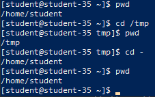

Команда `pwd` отображает абсолютный путь к текущей рабочей директории. С помощью `cd /tmp` выполнен переход во временный каталог, а команда `cd -` возвращает пользователя в предыдущую рабочую директорию.

## 2. Вывод списка файлов в директории

```shell
ls -l
```

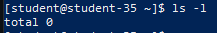

Команда `ls -l` формирует развёрнутый список файлов и каталогов текущей директории с подробными атрибутами: типом объекта, правами доступа, количеством ссылок, владельцем, группой, размером и датой последнего изменения.

## 3. Вывод полного списка файлов, включая скрытые

```shell
ls -la
```

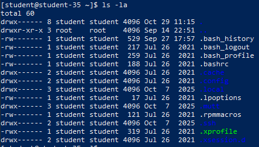

Параметр `-a` указывает на необходимость отображения всех объектов без исключения, включая скрытые конфигурационные файлы (начинающиеся с точки), а также специальные указатели на текущий (`.`) и родительский (`..`) каталоги.

## 4. Создание структуры каталогов с несколькими уровнями вложенности

```shell
mkdir -p project/level1/level2/backup
find project -type d
```

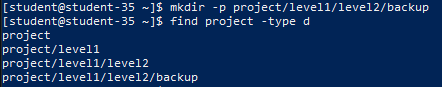

Флаг `-p` позволяет рекурсивно создать всю цепочку подкаталогов за один вызов, автоматически создавая недостающие родительские папки. Команда `find project -type d` наглядно выводит полученную иерархию каталогов.

## 5. Создание файла внутри каталога и наполнение текстовыми строками

```shell
cat << 'EOF' > project/level1/fruits.txt
cherry
apple
orange
banana
EOF
cat project/level1/fruits.txt
```

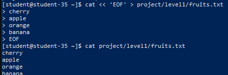

С помощью конструкции `cat << 'EOF'` и оператора перенаправления вывода в файл `project/level1/fruits.txt` записан многострочный перечень данных. Команда `cat` выводит записанный текст в терминал для проверки.

## 6. Перемещение файла в другой каталог

```shell
mv project/level1/fruits.txt project/level1/level2/
ls -l project/level1/level2/
```

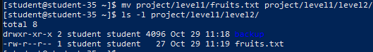

Утилита `mv` перемещает файл `fruits.txt` из директории `project/level1/` в подкаталог `project/level1/level2/`. Листинг целевой папки подтверждает успешное перемещение.

## 7. Копирование файла в другую директорию

```shell
cp project/level1/level2/fruits.txt project/level1/level2/backup/fruits_backup.txt
ls -l project/level1/level2/backup/
```

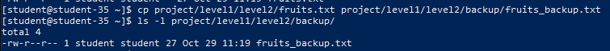

Команда `cp` создаёт дубликат файла по новому пути `project/level1/level2/backup/fruits_backup.txt`, сохраняя оригинал в исходной директории.

## 8. Переименование файла

```shell
mv project/level1/level2/backup/fruits_backup.txt project/level1/level2/backup/fruits_renamed.txt
ls -l project/level1/level2/backup/
```

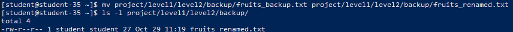

Переименование файла в Linux выполняется утилитой `mv` при указании нового имени в пределах той же директории. Файл `fruits_backup.txt` переименован в `fruits_renamed.txt`.

## 9. Сравнение содержимого двух файлов

```shell
diff -s project/level1/level2/fruits.txt project/level1/level2/backup/fruits_renamed.txt
```

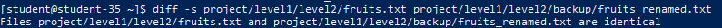

Утилита `diff` производит построчное сопоставление файлов. Ключ `-s` явно сообщает об идентичности файлов (`Files ... and ... are identical`), если различия отсутствуют.

## 10. Сортировка содержимого файла по возрастанию и убыванию

```shell
sort project/level1/level2/fruits.txt
sort -r project/level1/level2/fruits.txt
```

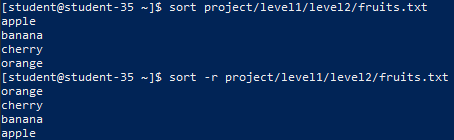

Команда `sort` выполняет лексикографическую сортировку строк файла по возрастанию (A-Z). Добавление флага `-r` (reverse) разворачивает порядок вывода, сортируя данные по убыванию (Z-A).

## 11. Рекурсивный поиск файла по имени

```shell
find project -name "fruits_renamed.txt"
```

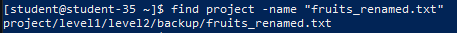

Утилита `find` выполняет обход файлового дерева каталога `project` и находит точный путь к файлу по заданному критерию `-name`, исключая необходимость ручной навигации по структуре.

## 12. Удаление созданных каталогов и файлов

```shell
rm -rf project
ls -ld project
```

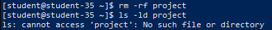

Команда `rm` с параметрами `-r` (рекурсивное удаление) и `-f` (принудительное удаление без запроса подтверждения) удаляет всё дерево каталогов `project`. Последующая проверка через `ls` возвращает сообщение об ошибке отсутствия файла, подтверждая полное удаление созданных объектов.

## Разница между абсолютным и относительным путём

- **Абсолютный путь** задаётся от самого корня файловой системы (символа `/`) и уникально указывает на объект независимо от текущего рабочего каталога (например, `/home/student/project/level1/fruits.txt`).
- **Относительный путь** строится относительно текущей рабочей директории, в которой находится пользователь в данный момент. Для навигации применяются специальные обозначения: `.` (текущий каталог) и `..` (родительский каталог на один уровень выше). Например: `project/level1/fruits.txt` или `../backup/fruits_renamed.txt`.
