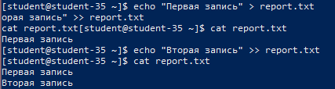
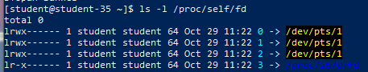
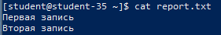
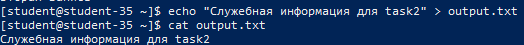
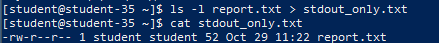
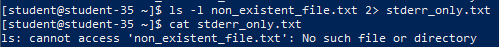
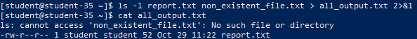
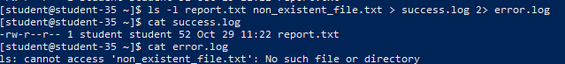
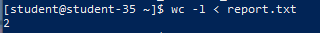
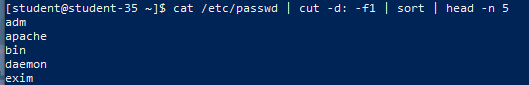

# Решение задач

## 1. Принцип работы операторов `>` и `>>`

```shell
echo "Первая запись" > report.txt
cat report.txt
echo "Вторая запись" >> report.txt
cat report.txt
```



Оператор `>` перенаправляет поток стандартного вывода в файл, создавая новый файл или полностью перезаписывая уже существующий. Оператор `>>` осуществляет перенаправление в режиме добавления (append), дописывая новые данные в конец файла без удаления существующего содержимого.

## 2. Стандартные потоки `stdin`, `stdout`, `stderr`

```shell
ls -l /proc/self/fd
```



В операционных системах семейства Linux каждый запускаемый процесс по умолчанию ассоциируется с тремя базовыми потоками ввода-вывода, представленными числовыми файловыми дескрипторами:

- `stdin` (дескриптор `0`) — стандартный поток ввода, используемый для считывания входных данных программой (по умолчанию ассоциирован с клавиатурой).
- `stdout` (дескриптор `1`) — стандартный поток вывода, куда направляются основные результаты успешного выполнения (по умолчанию ассоциирован с окном терминала).
- `stderr` (дескриптор `2`) — стандартный поток ошибок, предназначенный для изоляции аварийных, сервисных и диагностических сообщений от основного потока данных (также выводится в терминал).

## 3. Вывод содержимого файла без использования текстовых редакторов

```shell
cat report.txt
```



Утилита `cat` считывает байты из указанного файла и транслирует их в поток `stdout`, обеспечивая быстрый просмотр данных в консоли без перехода в интерактивные редакторы (такие как `nano`, `vi` или `vim`).

## 4. Создание файла с содержимым без текстового редактора

```shell
echo "Служебная информация для task2" > output.txt
cat output.txt
```



С помощью утилиты `echo` формируется текстовая строка, которая оператором `>` сразу же направляется в файл `output.txt`. Если файла не существовало, файловая система создаёт его автоматически.

## 5. Перенаправление потоков вывода

### 5.1. Перенаправление только `stdout` в файл

```shell
ls -l report.txt > stdout_only.txt
cat stdout_only.txt
```



Конструкция `> stdout_only.txt` (эквивалентно явной записи `1>`) перехватывает исключительно стандартный вывод успешного выполнения команды. Если в процессе работы возникнут ошибки, они не попадут в данный файл, а отобразятся в терминале.

### 5.2. Перенаправление только `stderr` в файл

```shell
ls -l non_existent_file.txt 2> stderr_only.txt
cat stderr_only.txt
```



Указание дескриптора `2>` направляет в файл только поток ошибок. При попытке чтения несуществующего файла диагностическое сообщение оболочки записывается в `stderr_only.txt`.

### 5.3. Перенаправление `stdout` и `stderr` в один общий файл

```shell
ls -l report.txt non_existent_file.txt > all_output.txt 2>&1
cat all_output.txt
```



Запись `> all_output.txt 2>&1` сначала перенаправляет поток `1` (`stdout`) в файл, а затем перенаправляет поток `2` (`stderr`) туда же, куда направлен поток `1`. В результате и штатные данные, и ошибки фиксируются в едином журнале.

### 5.4. Раздельное перенаправление `stdout` и `stderr` в разные файлы

```shell
ls -l report.txt non_existent_file.txt > success.log 2> error.log
cat success.log
cat error.log
```



В рамках одной команды потоки физически разделяются: полезные данные уходят в `success.log`, а ошибки сохраняются в `error.log`.

## 6. Отличия между `stdout` и `stderr`

- Поток `stdout` (дескриптор `1`) служит для передачи полезных результатов работы утилиты. Эти данные предназначены для дальнейшей обработки пользователем или передачи по конвейеру следующей программе.
- Поток `stderr` (дескриптор `2`) служит для информирования пользователя или администратора о нештатных ситуациях, предупреждениях и сбоях.
- Разделение потоков гарантирует, что ошибки не повредят структуру данных при конвейерной передаче или при перенаправлении вывода в рабочие файлы.

## 7. Назначение `stdin` и передача данных через стандартный ввод

```shell
wc -l < report.txt
```



Поток `stdin` (дескриптор `0`) отвечает за приём внешних данных процессом. Оператор `<` перенаправляет поток чтения из файла `report.txt` на стандартный ввод утилиты `wc`. В таком режиме программа считывает данные из файла так, будто они поступили из клавиатурного ввода.

## 8. Отправка ненужного вывода команды в `/dev/null`

```shell
ping -c 2 127.0.0.1 > /dev/null 2>&1
```


Специальный файл виртуального устройства `/dev/null` играет роль приёмника данных, который мгновенно удаляет любую записанную в него информацию. Конструкция `> /dev/null 2>&1` заглушает и `stdout`, и `stderr`, обеспечивая абсолютно «тихое» выполнение команды.

## 9. Различие между конвейером `|` и перенаправлением `>`

- Оператор перенаправления `>` связывает стандартный вывод команды с файлом или устройством на диске, сохраняя данные в постоянное хранилище.
- Конвейерный оператор `|` (pipe) организует межпроцессный канал взаимодействия в оперативной памяти: стандартный вывод (`stdout`) программы слева непрерывно поступает на стандартный ввод (`stdin`) программы справа без записи на накопитель.

## 10. Конвейер из нескольких команд

```shell
cat /etc/passwd | cut -d: -f1 | sort | head -n 5
```



В данном примере объединены четыре утилиты:

1. `cat /etc/passwd` считывает базу пользователей системы;
2. `cut -d: -f1` вырезает первое поле каждой строки (логины пользователей);
3. `sort` производит алфавитную сортировку полученного списка;
4. `head -n 5` отбирает и отображает первые 5 строк итогового результата.

## 11. Очистка временных файлов

```shell
rm -f report.txt output.txt stdout_only.txt stderr_only.txt all_output.txt success.log error.log
```


После выполнения лабораторной работы все временные файлы журналов и вывода были удалены с помощью команды `rm -f`.

## Сводная информация по файловым дескрипторам

- **Дескриптор 0 (`stdin`)**: стандартный поток ввода для считывания входных данных.
- **Дескриптор 1 (`stdout`)**: стандартный поток вывода для штатных результатов.
- **Дескриптор 2 (`stderr`)**: стандартный поток ошибок для сервисных и аварийных сообщений.
