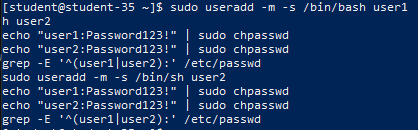
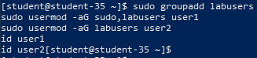
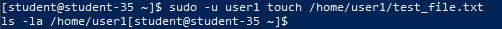
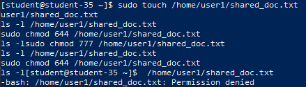
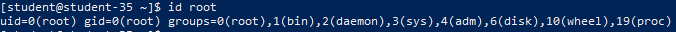
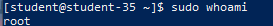
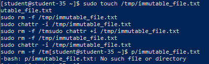
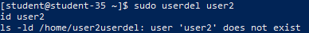
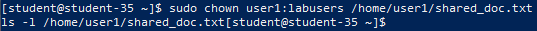
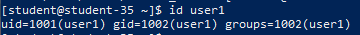

# Решение задач

## 1. Добавление пользователей `user1` и `user2`

```shell
sudo useradd -m -s /bin/bash user1
sudo useradd -m -s /bin/sh user2
echo "user1:Password123!" | sudo chpasswd
echo "user2:Password123!" | sudo chpasswd
grep -E '^(user1|user2):' /etc/passwd
```



Утилита `useradd` с ключом `-m` формирует домашний каталог пользователя, а флаг `-s` задаёт командную оболочку: `/bin/bash` для `user1` и `/bin/sh` для `user2`. Утилита `chpasswd` централизованно задаёт пароли, а чтение `/etc/passwd` подтверждает корректность созданных записей.

## 2. Создание группы `labusers` и распределение пользователей

```shell
sudo groupadd labusers
sudo usermod -aG sudo,labusers user1
sudo usermod -aG labusers user2
id user1
id user2
```



Команда `groupadd` создаёт группу `labusers`. С помощью `usermod` с параметрами `-aG` (добавление в дополнительные группы без исключения из существующих) пользователь `user1` включён в группы администраторов `sudo` и `labusers`, а `user2` — в группу `labusers`.

## 3. Права доступа и просмотр атрибутов файлов в домашней директории

```shell
sudo -u user1 touch /home/user1/test_file.txt
ls -la /home/user1
```



Права доступа в Linux — это совокупность атрибутов файла, регламентирующих возможности чтения (`r`), записи (`w`) и исполнения (`x`) для владельца (user), участников группы владельца (group) и остальных пользователей (others). Вывод `ls -la` демонстрирует установленные разрешения на объекты каталога пользователя `user1`.

## 4. Настройка прав доступа на файл и разбор избыточности прав 777

```shell
sudo touch /home/user1/shared_doc.txt
sudo chmod 777 /home/user1/shared_doc.txt
ls -l /home/user1/shared_doc.txt
sudo chmod 644 /home/user1/shared_doc.txt
ls -l /home/user1/shared_doc.txt
```



Назначение прав `777` (`rwxrwxrwx`) предоставляет полный неконтролируемый доступ любому пользователю и сервису в системе, что нарушает принцип наименьших привилегий и создаёт прямую угрозу безопасности (компрометация, искажение или удаление данных). После демонстрации права возвращены к нормативным `644` (`-rw-r--r--`), обеспечивая чтение всем и запись только владельцу.

## 5. Встроенная учётная запись администратора

```shell
id root
```



Встроенный суперадминистратор системы имеет имя `root` и фиксированные числовые идентификаторы `UID=0` и `GID=0`.

## 6. Выполнение команды с административными привилегиями

```shell
sudo whoami
```



Для разового выполнения команды с повышенными привилегиями от имени суперпользователя применяется утилита `sudo` (SuperUser DO), авторизующая действие в соответствии с правилами файла конфигурации `/etc/sudoers`.

## 7. Ограничения суперпользователя `root`

```shell
sudo touch /tmp/immutable_file.txt
sudo chattr +i /tmp/immutable_file.txt
sudo rm -f /tmp/immutable_file.txt
sudo chattr -i /tmp/immutable_file.txt
sudo rm -f /tmp/immutable_file.txt
```



Суперпользователь не обладает неограниченной властью. В системе действуют механизмы, способные заблокировать операции `root` независимо от стандартных прав:

- Специальные файловые атрибуты файловой системы (например, атрибут неизменяемости `+i`, установленный через `chattr`, запрещает удаление даже для `root`);
- Системы принудительного мандатного контроля доступа (MAC: SELinux, AppArmor), блокирующие действия, не предусмотренные политикой безопасности;
- Механизмы безопасности ядра (Secure Boot, Kernel Lockdown), запрещающие прямую модификацию памяти ядра и системных областей.

## 8. Удаление пользователя `user2` с сохранением домашнего каталога

```shell
sudo userdel user2
id user2
ls -ld /home/user2
```



Вызов `userdel` без опции `-r` удаляет пользователя из системных баз `/etc/passwd`, `/etc/shadow` и `/etc/group`, но оставляет каталог `/home/user2` на диске. Попытка запроса `id user2` подтверждает факт удаления учётной записи.

## 9. Смена владельца и группы файла

```shell
sudo chown user1:labusers /home/user1/shared_doc.txt
ls -l /home/user1/shared_doc.txt
```



Смена владельца и группы объекта производится утилитой `chown` с использованием синтаксиса `владелец:группа`. В результате владельцем файла стал `user1`, а ассоциированной группой — `labusers`.

## 10. Проверка идентификаторов и групп пользователя `user1`

```shell
id user1
```



Вывод утилиты `id` содержит числовой идентификатор пользователя (`uid`), его основной группы (`gid`), а также перечень всех вторичных (дополнительных) групп, в которых он состоит.

## Назначение прав доступа `r`, `w`, `x` для файлов и каталогов

- **Для обычных файлов**:
  - `r` (read): чтение содержимого файла;
  - `w` (write): изменение и дополнение содержимого файла;
  - `x` (execute): запуск файла в качестве бинарной программы или интерпретируемого скрипта.
- **Для каталогов**:
  - `r` (read): получение списка имён файлов внутри каталога (просмотр через `ls`);
  - `w` (write): создание, переименование и удаление файлов внутри каталога;
  - `x` (execute): право перехода в каталог (команда `cd`) и доступ к метаданным содержащихся в нём объектов.
