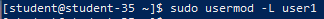
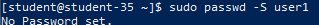
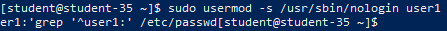
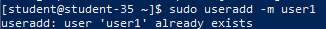
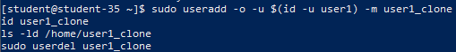
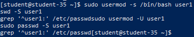

# Решение задач

## 1. Запрет входа в систему для пользователя `user1`

```shell
sudo usermod -L user1
```



Команда `usermod -L` (lock) блокирует учётную запись пользователя путём добавления символа восклицательного знака `!` перед захешированным паролем в файле `/etc/shadow`, что делает невозможным сопоставление введённого пароля.

## 2. Способ блокировки и проверка статуса учётной записи

```shell
sudo passwd -S user1
```



Для инспекции состояния учётной записи используется утилита `passwd` с ключом `-S`. Статус `L` (locked) подтверждает, что парольная аутентификация заблокирована (в отличие от активного статуса `P`).

## 3. Альтернативные способы запрета интерактивного входа

```shell
sudo usermod -s /usr/sbin/nologin user1
grep '^user1:' /etc/passwd
```



В операционной системе Linux существует несколько способов запретить интерактивный вход:

1. **Подмена командной оболочки на `/usr/sbin/nologin` или `/bin/false`**: запрещает запуск командного интерпретатора при входе, завершая сессию сразу после аутентификации.
2. **Истечение срока действия учётной записи**: команда `sudo chage -E 0 user1` (или `sudo usermod -e 1970-01-01 user1`) устанавливает срок действия в прошлое, вследствие чего система отклоняет попытку входа.
3. **Блокировка пароля через `passwd`**: команда `sudo passwd -l user1` аналогично блокирует хеш пароля.
4. **Глобальный запрет через `/etc/nologin`**: создание файла `/etc/nologin` блокирует доступ всем непривилегированным пользователям системы.

## 4. Возможность создания двух пользователей с одинаковым `username`

```shell
sudo useradd -m user1
```



Создать двух пользователей с одинаковым именем (`username`) невозможно. Имя пользователя выступает уникальным строковым идентификатором в файле `/etc/passwd` и службе NSS (Name Service Switch). При попытке повторного добавления утилита `useradd` возвращает ошибку `useradd: user 'user1' already exists`.

## 5. Возможность создания двух пользователей с одинаковым UID и реакция системы

```shell
sudo useradd -o -u $(id -u user1) -m user1_clone
id user1_clone
ls -ld /home/user1_clone
sudo userdel user1_clone
```



Создание пользователя с дублирующимся UID технически возможно при явном указании флага `-o` (`--non-unique`). Однако для ядра Linux реальным субъектом прав и владения процессами является исключительно числовой идентификатор UID, а не текстовое имя. В таком случае система считает обоих пользователей одной и той же сущностью: они делят одинаковые права доступа к файлам и процессам, а утилиты отображения (`ls`, `ps`) связывают UID с первым именем, встреченным в `/etc/passwd`.

## 6. Восстановление возможности входа для пользователя `user1`

```shell
sudo usermod -s /bin/bash user1
sudo usermod -U user1
sudo passwd -S user1
grep '^user1:' /etc/passwd
```



Команда `usermod -s /bin/bash` возвращает пользователю стандартную командную оболочку, а ключ `-U` (unlock) снимает блокировку с пароля в `/etc/shadow`. Команда `passwd -S` выводит флаг `P`, свидетельствуя об успешном восстановлении полноценной возможности авторизации в системе.
