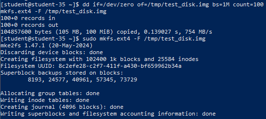
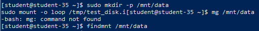
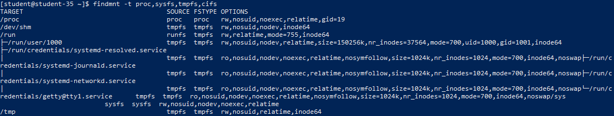
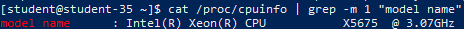
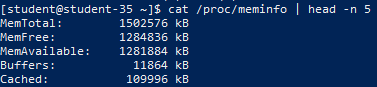
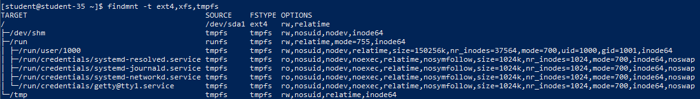
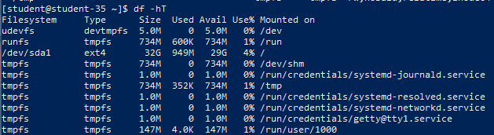
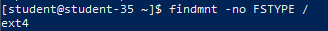

# Решение задач

## 1. Известные типы файловых систем

Файловые системы обеспечивают организацию, хранение и именование данных на носителях:

- **Дисковые файловые системы Linux**: `ext4`, `ext3`, `ext2`, `XFS`, `Btrfs`, `F2FS`.
- **Файловые системы Windows/совместимые**: `NTFS`, `FAT32` (`vfat`), `exFAT`.
- **Сетевые (распределённые)**: `NFS` (Network File System), `CIFS/SMB` (Common Internet File System / Samba), `SSHFS`, `GlusterFS`, `CephFS`.
- **Псевдо- и виртуальные (в памяти)**: `procfs` (`/proc`), `sysfs` (`/sys`), `tmpfs` (RAM-диск), `devtmpfs` (`/dev`).
- **Специальные**: `swap` (пространство подкачки), `overlayfs` (наложение слоёв), `iso9660` (образы оптических дисков).

## 2. Классификация файловых систем и их отличия

Файловые системы классифицируют по ключевым архитектурным признакам:

- **По среде размещения**:
  - *Локальные (дисковые)* — работают напрямую с физическими блочными устройствами (HDD, SSD, NVMe).
  - *Сетевые* — предоставляют доступ к файлам по локальной сети через клиент-серверные протоколы.
  - *Виртуальные* — не имеют постоянного дискового накопителя и генерируют структуры файлов динамически в ОЗУ.
- **По наличию журналирования**:
  - *Журналируемые* (`ext4`, `XFS`, `NTFS`) — фиксируют изменения в специальном журнале перед фактической записью, что защищает структуру ФС от повреждений при внезапном сбое питания.
  - *Нежурналируемые* (`ext2`, `FAT32`) — проще по структуре, но требуют долгой проверки целостности (`fsck`) после сбоев.
- **По поддержке Copy-on-Write (CoW)**:
  - Современные ФС (`Btrfs`, `ZFS`) не перезаписывают блоки данных на месте, а записывают их на новое место, позволяя мгновенно создавать снимки (snapshots) и субтома.

## 3. Файловые системы, применяемые в Linux

- **`ext4`**: зрелый стандарт по умолчанию для большинства серверных и настольных дистрибутивов (Debian, Ubuntu), отличающийся высокой стабильностью и производительностью при общих нагрузках.
- **`XFS`**: высокопроизводительная 64-битная журналируемая ФС, отлично работающая с файлами огромного размера и многопоточным параллельным вводом-выводом (стандарт в RHEL, CentOS, Rocky, Alma Linux).
- **`Btrfs`**: современная CoW-система со встроенной поддержкой снапшотов, пулов дисков и самовосстановления метаданных (стандарт в openSUSE и Fedora).
- **`tmpfs`**: используется для каталогов `/tmp`, `/run`, обеспечивая максимальную скорость за счёт хранения данных в оперативной памяти.

## 4. Создание файловой системы на блочном устройстве

```shell
sudo mkfs.ext4 /dev/sdb1
```



Утилиты семейства `mkfs` (`mkfs.ext4`, `mkfs.xfs`) инициализируют суперблок, таблицы инодов (inodes), блоки данных и журнал на выбранном дисковом разделе.

## 5. Понятие монтирования и подключение файловой системы

```shell
sudo mkdir -p /mnt/data
sudo mount /dev/sdb1 /mnt/data
findmnt /mnt/data
```



Монтирование — это процедура связывания файловой системы на физическом носителе с определённым каталогом единого дерева каталогов Linux (точкой монтирования). После выполнения `mount` содержимое примонтированного раздела становится доступным внутри указанной папки.

## 6. Особенности виртуальных и сетевых файловых систем

- **`procfs` (`/proc`)**: виртуальная файловая система ядра, предоставляющая интерфейс к структурам данных ядра, списку процессов (PID) и параметрам оборудования.
- **`sysfs` (`/sys`)**: экспортирует в виде иерархии каталогов информацию обо всех физических и виртуальных устройствах, драйверах и модулях ядра.
- **`tmpfs`**: хранит файлы непосредственно в оперативной памяти (с возможностью вытеснения в swap), гарантируя минимальные задержки доступа и автоматическую очистку при перезагрузке.
- **`cifs`**: клиент сетевого протокола SMB/CIFS, позволяющий монтировать общие папки Windows и файловых серверов Samba.

Поиск точек монтирования данных систем:

```shell
findmnt -t proc,sysfs,tmpfs,cifs
```



Команда `findmnt -t` фильтрует дерево монтирования и выводит все каталоги, куда в данный момент подключены указанные типы файловых систем.

## 7. Получение информации о системе из виртуальной ФС `/proc`

### 7.1. Информация о процессоре (CPU)

```shell
cat /proc/cpuinfo | grep -m 1 "model name"
```



Файл `/proc/cpuinfo` генерируется ядром на лету при чтении и содержит полную аппаратную спецификацию процессора: модель, тактовую частоту, кэш и поддерживаемые флаги инструкций.

### 7.2. Информация о состоянии памяти (RAM)

```shell
cat /proc/meminfo | head -n 5
```



Файл `/proc/meminfo` отображает актуальные показатели подсистемы памяти ядра: общий объём RAM (`MemTotal`), объём свободной памяти (`MemFree`) и доступной для запуска приложений памяти (`MemAvailable`).

## 8. Список точек монтирования двумя разными способами

### Способ 1: Утилита `findmnt`

```shell
findmnt -t ext4,xfs,tmpfs
```



Команда `findmnt` отображает структурированное дерево текущих точек монтирования, их типы и параметры монтирования.

### Способ 2: Утилита `df` с указанием типа ФС

```shell
df -hT
```



Утилита `df` с параметрами `-h` (human-readable) и `-T` (тип файловой системы) выводит перечень подключённых устройств, их тип, ёмкость, занятый объём и точку монтирования в виде таблицы.

## Определение типа файловой системы для точки монтирования `/`

```shell
findmnt -no FSTYPE /
```



Ключ `-no FSTYPE` позволяет точно определить используемую файловую систему корневого раздела без вывода заголовков и лишних столбцов.

## Различие между дисковыми ФС и виртуальными ФС (`/proc`, `/sys`)

- **Дисковые файловые системы (`ext4`, `XFS`)**:
  - Хранят реальные данные на физических энергонезависимых носителях (HDD/SSD).
  - Имеют постоянные метаданные на диске (суперблок, иноды, битовые карты).
  - Сохраняют информацию после перезагрузки компьютера.
- **Виртуальные файловые системы (`/proc`, `/sys`)**:
  - Не занимают места на диске и существуют исключительно в оперативной памяти ядра.
  - Файлы генерируются динамически в момент их чтения пользовательскими программами.
  - Служат интерактивным программным интерфейсом (API) между ядром операционной системы и пространством пользователя.
