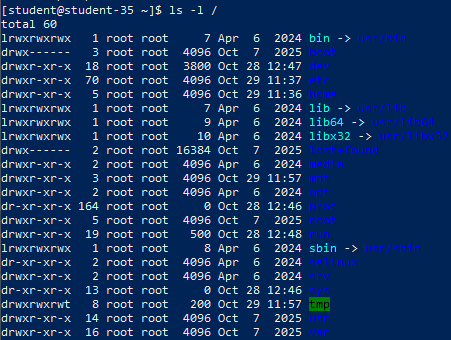
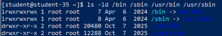
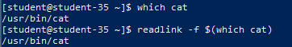

# Решение задач

## 1. Структура каталогов Linux и список объектов в корне системы

```shell
ls -l /
```



В Linux используется иерархическая древовидная структура каталогов согласно стандарту FHS (Filesystem Hierarchy Standard). Все пути начинаются с единого корневого каталога `/`. Команда `ls -l /` отображает перечень основных системных папок и ссылок первого уровня.

## 2. Размещение домашних каталогов обычных пользователей

Домашние каталоги непривилегированных учётных записей размещаются в папке `/home` (например, `/home/student` или `/home/user1`). В этих каталогах хранятся пользовательские документы, проекты и индивидуальные конфигурационные файлы (скрытые dot-файлы).

## 3. Размещение домашнего каталога суперпользователя

Домашний каталог администратора системы `root` вынесен непосредственно в корень файловой системы — `/root`. Это сделано для того, чтобы администратор мог авторизоваться и восстановить работоспособность сервера, даже если раздел `/home` повреждён или не примонтирован.

## 4. Размещение системных конфигурационных файлов

Основные общесистемные конфигурационные файлы хранятся в каталоге `/etc`. Здесь располагаются настройки сетевых служб, параметры демонов, файлы учётных записей (`passwd`, `shadow`), параметры монтирования (`fstab`) и списки репозиториев пакетов.

## 5. Назначение основных системных каталогов

- **`/bin`**: базовые системные исполняемые файлы и утилиты командной оболочки, необходимые для начальной загрузки и работы в однопользовательском режиме (`ls`, `cat`, `cp`, `bash`).
- **`/sbin`**: важнейшие бинарные файлы системного администрирования, запускаемые с правами суперпользователя (`fdisk`, `reboot`, `ip`, `mkfs`).
- **`/usr/bin`**: основной массив пользовательских программ и утилит, установленных из пакетов дистрибутива.
- **`/usr/sbin`**: вспомогательные системные демоны и административные инструменты, не требующиеся на этапе начального старта ядра.
- **`/etc`**: статические конфигурационные файлы операционной системы и установленных сервисов.
- **`/var`**: переменные данные процессов, регулярно изменяющиеся в ходе работы системы: журналы (`/var/log`), базы данных (`/var/lib`), почта (`/var/mail`), блокировки (`/var/lock`).
- **`/tmp`**: хранилище временных файлов программ, доступное на запись всем пользователям (автоматически очищается при перезагрузке).
- **`/home`**: точки размещения домашних директорий пользователей.
- **`/root`**: домашний каталог суперадминистратора `root`.
- **`/proc`**: виртуальная файловая система ядра для доступа к информации о процессах и характеристиках оборудования.
- **`/sys`**: виртуальная файловая система экспорта информации ядра об устройствах, драйверах и подсистемах шин.

## 6. Проверка каталогов `/bin` и `/sbin` на символические ссылки

```shell
ls -ld /bin /sbin /usr/bin /usr/sbin
```



В современных дистрибутивах Linux (схема UsrMerge) каталоги `/bin` и `/sbin` являются символическими ссылками (symlinks), указывающими соответственно на `/usr/bin` и `/usr/sbin`. Это обеспечивает унификацию исполняемых файлов в едином каталоге `/usr`.

## 7. Поиск физического расположения исполняемого файла

```shell
which cat
readlink -f $(which cat)
```



Утилита `which` находит путь к программе в системных переменных `PATH`, а команда `readlink -f` раскрывает цепочку символических ссылок и выводит реальный физический путь к исполняемому файлу на диске.

## Различия между обычным каталогом, символической ссылкой и виртуальной ФС

- **Обычный каталог**: запись в файловой системе с инодом типа `d` (directory), содержащая таблицу сопоставления имён файлов и их номеров инодов на физическом носителе.
- **Символическая ссылка (symlink)**: специальный файл с типом `l`, в блоках данных которого записан текстовый путь к целевому объекту. При обращении к ссылке ядро прозрачно перенаправляет операцию на цель.
- **Виртуальная файловая система (`/proc`, `/sys`)**: динамическая абстракция ядра в ОЗУ, которая не хранится на диске, а генерирует виртуальное дерево файлов и папок в реальном времени при чтении.
