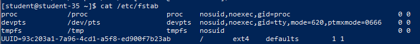
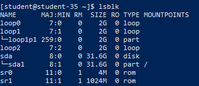
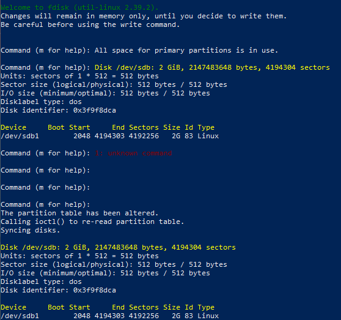
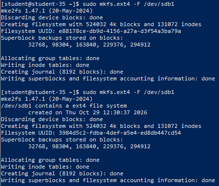
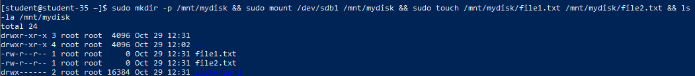
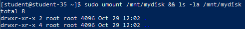
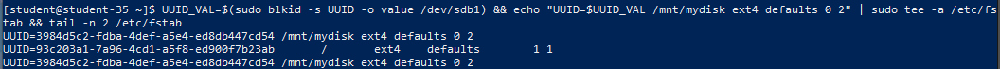
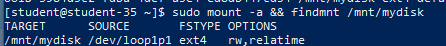
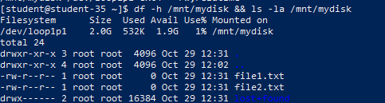

# Решение задач

## 1. Содержимое и назначение файла `/etc/fstab`

```shell
cat /etc/fstab
```



Файл `/etc/fstab` (File Systems Table) представляет собой системную конфигурационную таблицу, содержащую статическую информацию о дисковых разделах, сетевых хранилищах и виртуальных файловых системах, которые должны автоматически монтироваться при старте операционной системы. Каждая строка задаёт: идентификатор устройства (UUID/путь), точку монтирования, тип файловой системы, опции монтирования, флаг резервного копирования (`dump`) и порядок проверки целостности (`fsck`).

## 2. Добавление виртуального диска в систему

Новый виртуальный накопитель (например, объёмом 5–10 ГБ) добавляется через настройки гипервизора виртуальной машины. После горячего подключения или повторного сканирования шины SCSI диск регистрируется ядром.

## 3. Обнаружение нового диска и список блочных устройств

```shell
lsblk
```



Утилита `lsblk` выводит древовидную структуру всех подключённых блочных устройств системы. Новый диск определяется как неразмеченное устройство `/dev/sdb`.

## 4. Создание таблицы разделов и раздела на диске

```shell
echo -e "n\np\n1\n\n\nw" | sudo fdisk /dev/sdb
sudo fdisk -l /dev/sdb
```



С помощью интерактивной утилиты `fdisk` на накопителе создана таблица разделов MBR (DOS) и создан первичный раздел `/dev/sdb1` на весь объём диска. Запись таблицы на диск подтверждается итоговым выводом `fdisk -l`.

## 5. Создание файловой системы `ext4` на разделе

```shell
sudo mkfs.ext4 /dev/sdb1
```



Команда `mkfs.ext4` размечает блочное устройство `/dev/sdb1`, создавая структуру инодов, блоки данных и журнал файловой системы ext4.

## 6. Монтирование файловой системы и создание тестовых файлов

```shell
sudo mkdir -p /mnt/mydisk
sudo mount /dev/sdb1 /mnt/mydisk
sudo touch /mnt/mydisk/file1.txt /mnt/mydisk/file2.txt
ls -la /mnt/mydisk
```



Создан каталог монтирования `/mnt/mydisk`, куда командой `mount` подключён раздел `/dev/sdb1`. Внутри файловой системы успешно созданы проверочные файлы `file1.txt` и `file2.txt`.

## 7. Размонтирование диска и проверка каталога

```shell
sudo umount /mnt/mydisk
ls -la /mnt/mydisk
```



После размонтирования командой `umount` каталог `/mnt/mydisk` оказывается пустым. Это объясняется тем, что точка монтирования в Linux является лишь ссылкой на корень подключённой файловой системы: когда диск отмонтирован, каталог отображает собственное пустое содержимое корневой файловой системы, в то время как созданные файлы сохранены на накопителе `/dev/sdb1`.

## 8. Определение UUID и настройка автозапуска в `/etc/fstab`

```shell
sudo blkid /dev/sdb1
UUID_VAL=$(sudo blkid -s UUID -o value /dev/sdb1)
echo "UUID=$UUID_VAL /mnt/mydisk ext4 defaults 0 2" | sudo tee -a /etc/fstab
tail -n 2 /etc/fstab
```



Использование постоянного уникального идентификатора `UUID` вместо имени устройства (`/dev/sdb1`) предотвращает ошибки монтирования в случае изменения порядка нумерации дисков контроллером при добавлении или отключении накопителей.

## 9. Проверка корректности `/etc/fstab` до перезагрузки

```shell
sudo mount -a
findmnt /mnt/mydisk
```



Команда `mount -a` монтирует все файловые системы, описанные в `/etc/fstab`. Если в конфигурационном файле допущена синтаксическая ошибка, утилита немедленно выведет предупреждение, предотвращая сбой аварийного режима (emergency mode) при последующем старте системы.

## 10. Проверка автоматического монтирования после перезагрузки

```shell
df -h /mnt/mydisk
ls -la /mnt/mydisk
```



После перезагрузки сервера (`sudo reboot`) утилита `df -h` подтверждает, что раздел автоматически примонтирован в каталог `/mnt/mydisk`, а файлы `file1.txt` и `file2.txt` доступны для чтения и модификации.
