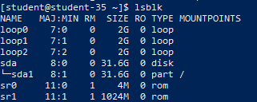
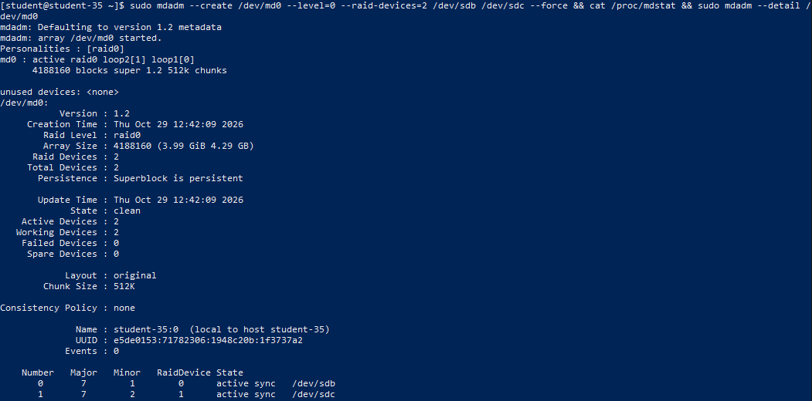
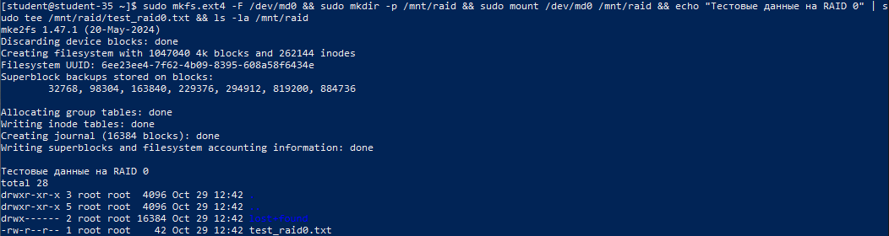
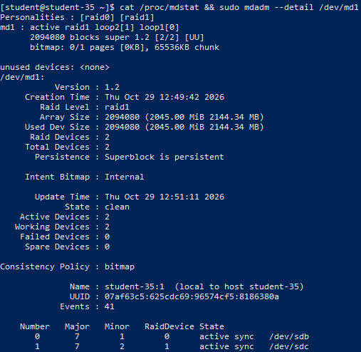
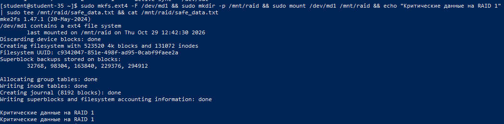
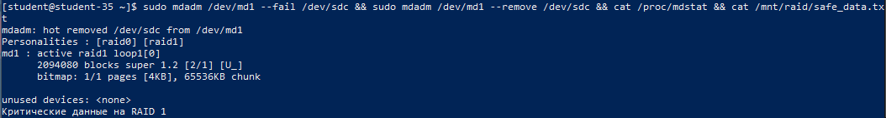
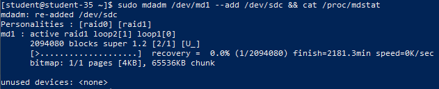

# Решение задач

## 1. Понятие RAID и основные уровни массивов

Технология RAID (Redundant Array of Independent Disks) объединяет несколько физических дисков в единый логический массив для увеличения производительности, обеспечения отказоустойчивости или совмещения обоих факторов:

- **RAID 0 (Striping)**: чередование блоков данных по всем дискам без избыточности. Обеспечивает максимальную скорость чтения и записи, но не имеет отказоустойчивости: выход из строя хотя бы одного диска приводит к потере всех данных.
- **RAID 1 (Mirroring)**: зеркалирование данных. Все блоки дублируются на двух или более дисках. Обеспечивает высокую надёжность (массив выдерживает отказ одного из дисков), но полезный объём равен объёму наименьшего диска.
- **RAID 5 (Striping with distributed parity)**: чередование данных с распределённым вычислением контрольных сумм чётности. Требует от 3 дисков, выдерживает отказ одного диска, полезный объём равен `(N-1) * размер диска`.
- **RAID 6**: аналогичен RAID 5, но хранит двойную чётность. Требует от 4 дисков и переживает одновременный выход из строя двух дисков.
- **RAID 10 (1+0)**: массив RAID 0 из зеркал RAID 1. Совмещает высокую скорость чередования и надёжность зеркалирования.

## 2. Обнаружение дополнительных дисков в системе

```shell
lsblk
```



В конфигурации виртуальной машины подключены два дополнительных виртуальных диска равного объёма: `/dev/sdb` и `/dev/sdc`.

## 3. Создание массива RAID 0 и проверка его состояния

```shell
sudo mdadm --create /dev/md0 --level=0 --raid-devices=2 /dev/sdb /dev/sdc --force
cat /proc/mdstat
sudo mdadm --detail /dev/md0
```



Утилита `mdadm` инициализирует программный массив RAID 0 с идентификатором `/dev/md0`, распределяя чередование блоков между накопителями `/dev/sdb` и `/dev/sdc`. Просмотр файла `/proc/mdstat` и детальный статус через `mdadm --detail` подтверждают активное состояние массива (статус `active raid0`).

## 4. Создание файловой системы на RAID 0, монтирование и запись файлов

```shell
sudo mkfs.ext4 /dev/md0
sudo mkdir -p /mnt/raid
sudo mount /dev/md0 /mnt/raid
echo "Тестовые данные на RAID 0" | sudo tee /mnt/raid/test_raid0.txt
ls -la /mnt/raid
```



Файловая система `ext4` создана непосредственно на составном блочном устройстве `/dev/md0`. Монтирование и запись тестового файла прошли успешно.

## 5. Остановка и удаление RAID 0, создание массива RAID 1

```shell
sudo umount /mnt/raid
sudo mdadm --stop /dev/md0
sudo mdadm --zero-superblock /dev/sdb /dev/sdc
sudo mdadm --create /dev/md1 --level=1 --raid-devices=2 /dev/sdb /dev/sdc --force
cat /proc/mdstat
sudo mdadm --detail /dev/md1
```



Массив `/dev/md0` остановлен, а суперблоки на дисках очищены утилитой `mdadm --zero-superblock`. Далее на тех же дисках собран массив зеркалирования RAID 1 (`/dev/md1`). Вывод подтверждает состояние `active raid1` с двумя активными дисками `[UU]`.

## 6. Создание ФС на RAID 1 и проверка чтения/записи

```shell
sudo mkfs.ext4 /dev/md1
sudo mount /dev/md1 /mnt/raid
echo "Критические данные на отказоустойчивом RAID 1" | sudo tee /mnt/raid/safe_data.txt
cat /mnt/raid/safe_data.txt
```



Файловая система развёрнута на зеркальном массиве `/dev/md1`. Данные записаны и проверены командой `cat`.

## 7. Имитация отказа диска RAID 1 и проверка доступности данных

```shell
sudo mdadm /dev/md1 --fail /dev/sdc
sudo mdadm /dev/md1 --remove /dev/sdc
cat /proc/mdstat
cat /mnt/raid/safe_data.txt
```



С помощью ключа `--fail` диск `/dev/sdc` переведён в аварийное состояние, после чего удалён из массива ключом `--remove`. В `/proc/mdstat` статус массива изменился на деградированный `[U_]` (один диск активен, второй отсутствует). Несмотря на отказ накопителя, файлы в `/mnt/raid/safe_data.txt` остаются полностью доступными для чтения и записи.

## 8. Добавление диска обратно и наблюдение за процессом восстановления (Rebuild)

```shell
sudo mdadm /dev/md1 --add /dev/sdc
cat /proc/mdstat
```



После возврата диска командой `--add` ядро автоматически запускает фоновый процесс ресинхронизации (resync/recovery). В выводе `/proc/mdstat` отображается прогресс восстановления в процентах, после завершения которого массив возвращается в полноценное зеркальное состояние `[UU]`.

## 9. Файловые системы со встроенными функциями RAID

Файловые системы нового поколения `ZFS` (пулы zpool с режимами mirror, raidz1, raidz2) и `Btrfs` (встроенные профили данных raid0, raid1, raid10) не требуют внешних утилит программного RAID (таких как `mdadm`). Они управляют избыточностью и распределением данных на уровне блоков файловой системы.

## 10. Создание RAID во время установки Linux

Да, установщики практически всех серверных дистрибутивов (Debian-Installer, Subiquity в Ubuntu Server, Anaconda в RHEL/CentOS/Fedora) поддерживают настройку программного RAID на этапе разметки дисков до развёртывания операционной системы.

## Сравнение RAID 0 и RAID 1

- **Производительность**:
  - `RAID 0`: высокая скорость как при чтении, так и при записи (данные пишутся параллельно).
  - `RAID 1`: высокая скорость чтения (чтение распределяется по дискам), но скорость записи ограничена самым медленным диском зеркала.
- **Полезный объём**:
  - `RAID 0`: 100% суммарного объёма всех дисков (`N * размер диска`).
  - `RAID 1`: 50% при использовании 2 дисков (объём одного диска).
- **Отказоустойчивость**:
  - `RAID 0`: нулевая. Сбой одного диска уничтожает весь массив.
  - `RAID 1`: высокая. Массив продолжает штатно работать при выходе из строя одного диска.
