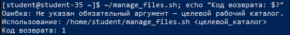
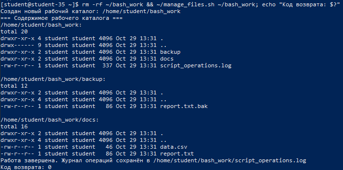
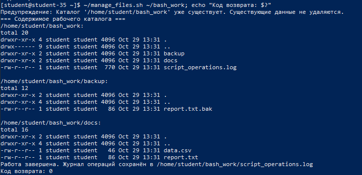
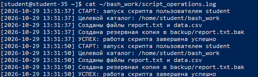

# Решение задач

## 1. Понятие и назначение Shebang

Шебанг (Shebang, Hashbang) — это последовательность из двух символов `#!` в самом начале первой строки текстового исполняемого файла. Шебанг указывает ядру операционной системы путь к интерпретатору, который должен быть запущен для обработки команд данного сценария.

При запуске исполняемого файла ядро считывает заголовок: если файл начинается с байтов `0x23 0x21` (`#!`), система извлекает остаток первой строки как команду и путь к интерпретатору (например, `#!/bin/bash` или `#!/usr/bin/env bash`), передавая путь к исполняемому файлу в качестве аргумента.

## 2. Необходимость расширения `.sh` для исполняемых файлов

В операционных системах семейства Linux расширение файла (`.sh`, `.bash`, `.py` и др.) носит исключительно информационный характер для удобства пользователя и редакторов кода. Для операционной системы расширение не является обязательным признаком исполняемого файла.

Файл становится исполняемым благодаря:

- Установке бита права на исполнение (`x`, execute) в атрибутах прав доступа POSIX (`chmod +x script_name`).
- Наличию корректного шебанга на первой строке либо бинарному заголовку формата ELF (для скомпилированных программ).

Таким образом, файл без какого-либо расширения (например, `manage_files`) выполняется системой штатно при наличии атрибута `chmod +x` и шебанга.

## 3. Назначение параметров режима `set -euo pipefail`

Использование директивы `set -euo pipefail` в начале Bash-сценариев является стандартом надёжного написания кода («строгий режим» Bash, Strict Mode):

- `-e` (`set -o errexit`): приводит к немедленному аварийному завершению скрипта, если любая вызванная команда завершается с ненулевым кодом возврата (ошибкой). Это предотвращает каскадное выполнение последующих разрушительных команд при сбое на промежуточных этапах.
- `-u` (`set -o nounset`): заставляет интерпретатор трактовать обращение к любой неинициализированной (необъявленной) переменной как фатальную ошибку и прерывать выполнение. Это защищает от опечаток в именах переменных и опасных ситуаций вида `rm -rf "$MISTYPED_PATH/"`.
- `-o pipefail`: изменяет логику обработки кодов возврата в конвейерах (`pipe`). По умолчанию код возврата конвейера равен коду последней команды. Флаг `pipefail` устанавливает код возврата конвейера равным коду последней (самой правой) команды, завершившейся с ошибкой, гарантируя, что скрытые ошибки в цепочках вида `cmd_with_error | grep something` не будут проигнорированы.

## 4. Полный текст скрипта автоматизации `manage_files.sh`

```bash
#!/bin/bash
set -euo pipefail

# Проверка передачи обязательного первого аргумента (целевой каталог)
if [ $# -lt 1 ] || [ -z "$1" ]; then
    echo "Ошибка: Не указан обязательный аргумент — целевой рабочий каталог." >&2
    echo "Использование: $0 <целевой_каталог>" >&2
    exit 1
fi

TARGET_DIR="$1"
LOG_FILE="${TARGET_DIR}/script_operations.log"

# Проверка существования каталога для предотвращения перезаписи без предупреждения
if [ -d "$TARGET_DIR" ]; then
    echo "Предупреждение: Каталог '$TARGET_DIR' уже существует. Существующие данные не удаляются."
else
    mkdir -p "$TARGET_DIR"
    echo "Создан новый рабочий каталог: $TARGET_DIR"
fi

# Запись заголовка сессии в лог
echo "[$(date '+%Y-%m-%d %H:%M:%S')] СТАРТ: запуск скрипта пользователем $(whoami)" >> "$LOG_FILE"
echo "[$(date '+%Y-%m-%d %H:%M:%S')] Целевой каталог: $TARGET_DIR" >> "$LOG_FILE"

# Создание структуры подкаталогов и файлов
mkdir -p "$TARGET_DIR/docs" "$TARGET_DIR/backup"
touch "$TARGET_DIR/docs/report.txt" "$TARGET_DIR/docs/data.csv"

# Запись данных в файлы
echo "Системный отчёт сформирован: $(date)" > "$TARGET_DIR/docs/report.txt"
echo "id,service,status;1,sshd,active;2,cron,active" > "$TARGET_DIR/docs/data.csv"
echo "[$(date '+%Y-%m-%d %H:%M:%S')] Созданы файлы report.txt и data.csv" >> "$LOG_FILE"

# Копирование в резервный каталог
cp "$TARGET_DIR/docs/report.txt" "$TARGET_DIR/backup/report.txt.bak"
echo "[$(date '+%Y-%m-%d %H:%M:%S')] Создана резервная копия в backup/report.txt.bak" >> "$LOG_FILE"

# Просмотр дерева файлов
echo "=== Содержимое рабочего каталога ==="
ls -laR "$TARGET_DIR"

echo "[$(date '+%Y-%m-%d %H:%M:%S')] УСПЕХ: работа скрипта завершена успешно" >> "$LOG_FILE"
echo "Работа завершена. Журнал операций сохранён в $LOG_FILE"
exit 0
```

## 5. Запуск скрипта без аргументов и код ошибки

При вызове скрипта без передачи аргумента целевого каталога срабатывает проверка входных параметров. В поток ошибок `stderr` выводится информативное сообщение о корректном синтаксисе, а выполнение прерывается с ненулевым кодом завершения `1`.

```shell
~/manage_files.sh
echo $?
```



## 6. Успешный запуск скрипта с передачей рабочего каталога

Скрипт вызывается с аргументом `~/bash_work`. Создаётся дерево каталогов, генерируются файлы с данными, создаётся резервная копия, ведётся протоколирование в лог-файл, а скрипт возвращает код завершения `0`.

```shell
~/manage_files.sh ~/bash_work
echo $?
```



## 7. Повторный запуск скрипта и защита данных

При повторном вызове скрипта с тем же каталогом срабатывает проверка существования директории: выводится предупреждение, данные не затираются, а новая сессия корректно дописывается в журнал операций.

```shell
~/manage_files.sh ~/bash_work
echo $?
```



## 8. Просмотр созданного лог-файла операций

Журнал `script_operations.log` фиксирует временные метки всех операций, имя пользователя, создание файлов, резервное копирование и успешное завершение каждого запуска.

```shell
cat ~/bash_work/script_operations.log
```


