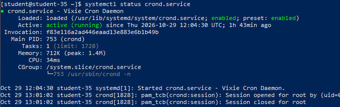
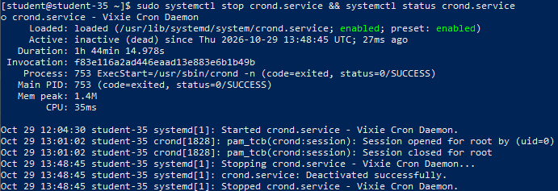
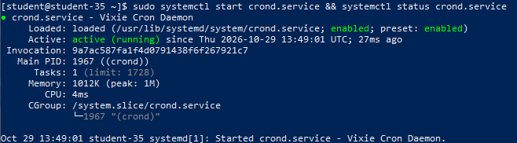
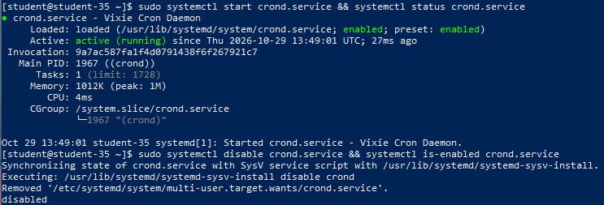
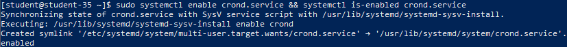
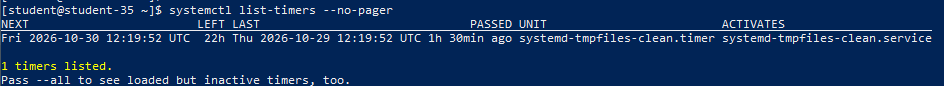

# Решение задач

## 1. Понятие и назначение Systemd Unit

В подсистеме инициализации и управления службами systemd **unit (юнит)** представляет собой базовую сущность (строительный блок), описывающую объект, которым systemd может управлять и отслеживать его жизненный цикл.

Каждый юнит конфигурируется с помощью декларативного текстового файла с соответствующим суффиксом типа. Основные типы юнитов:

- `.service`: системные службы и демоны (запуск, перезапуск, контроль процессов).
- `.timer`: таймеры для планирования периодического запуска сервисов (альтернатива cron).
- `.target`: группы юнитов, задающие целевые состояния системы (аналоги уровней выполнения runlevel, например `multi-user.target`, `graphical.target`).
- `.mount` и `.automount`: точки монтирования файловых систем.
- `.socket`: сокеты межпроцессного взаимодействия или сетевые сокеты для активации служб по требованию (socket activation).
- `.path`: мониторинг изменений файлов и директорий.

Конфигурационные файлы юнитов располагаются в `/usr/lib/systemd/system/` (системные пакетные юниты по умолчанию) и `/etc/systemd/system/` (пользовательские и переопределённые администратором юниты, имеющие наивысший приоритет).

## 2. Проверка статуса Systemd Unit

Для демонстрации выбран системный демон периодических задач `crond.service` (служба планировщика cron).

```shell
systemctl status crond.service
```



Команда `systemctl status` выводит подробную диагностическую сводку:

- `Loaded`: путь к unit-файлу, статус загрузки и текущее состояние автозагрузки (`enabled` / `disabled`).
- `Active`: текущее состояние жизненного цикла (`active (running)`, `inactive (dead)`, `failed`) и время нахождения в нём.
- `Main PID`: идентификатор главного процесса демона и имя исполняемого файла.
- `Tasks`: количество активных потоков/задач процесса и лимит cgroup.
- `Memory` / `CPU`: потребление оперативной памяти и процессорного времени.
- `CGroup`: путь контрольной группы cgroup, в которой изолированы все дочерние процессы юнита.
- Последние строки журнала `journald`, относящиеся к данному юниту.

## 3. Остановка сервиса

Остановка выполняется командой `systemctl stop`.

```shell
sudo systemctl stop crond.service
systemctl status crond.service
```



Сервис корректно завершил работу. Статус перешёл в `Active: inactive (dead)`. Процессы юнита остановлены, ресурсы cgroup освобождены.

## 4. Повторный запуск сервиса

Запуск выполняется командой `systemctl start`.

```shell
sudo systemctl start crond.service
systemctl status crond.service
```



Служба снова запущена и перешла в состояние `Active: active (running)` с выделением нового `Main PID`.

## 5. Отключение сервиса из автозагрузки

Отключение автозапуска выполняется командой `systemctl disable`.

```shell
sudo systemctl disable crond.service
systemctl is-enabled crond.service
```



Команда удалила символическую ссылку на юнит из директории автозагрузки соответствующего таргета (`/etc/systemd/system/multi-user.target.wants/crond.service`). Проверка `systemctl is-enabled` подтверждает состояние `disabled`. При следующей перезагрузке ОС служба автоматически не запустится.

## 6. Включение сервиса в автозагрузку

Включение в автозагрузку выполняется командой `systemctl enable`.

```shell
sudo systemctl enable crond.service
systemctl is-enabled crond.service
```



Утилита восстановила символическую ссылку в `/etc/systemd/system/multi-user.target.wants/`. Проверка `systemctl is-enabled` возвращает `enabled`.

## 7. Различия состояний сервисов и параметров автозагрузки

Необходимо строго разграничивать текущее состояние процесса в памяти и конфигурацию автозапуска:

- **Текущее состояние процесса (Runtime State)**:
  - `active`: процесс службы успешно запущен и в данный момент выполняет работу в памяти (`active (running)`) либо успешно выполнил однократную задачу (`active (exited)` для `Type=oneshot`).
  - `inactive`: служба в данный момент не запущена (`inactive (dead)`).
  - `failed`: процесс службы завершился аварийно (с ненулевым кодом выхода, сигналом ошибки, нарушением таймаута старта или сбоем перезапуска).
- **Состояние автозагрузки (Enablement / Boot State)**:
  - `enabled`: создана символическая ссылка в каталоге зависимостей таргета; служба гарантированно стартует при следующей загрузке ОС.
  - `disabled`: символическая ссылка отсутствует; при загрузке системы служба запущена не будет (хотя администратор может запустить её вручную командой `systemctl start`).

Сервис может быть одновременно `active` и `disabled` (работает прямо сейчас, но не включён в автозагрузку), либо `inactive` и `enabled` (остановлен администратором, но поднимется после перезагрузки).

## 8. Понятие Systemd Timers

**Systemd Timers** — это специальные юниты с суффиксом `.timer`, предназначенные для запуска других юнитов (по умолчанию одноимённого `.service`) по заданному временному расписанию или событию.

Таймеры systemd заменяют классический демон `cron`, предоставляя ряд преимуществ:

- Детальная точность до миллисекунд и гибкие календари (`OnCalendar=`).
- Возможность запуска относительно событий системы: через заданное время после загрузки ядра (`OnBootSec=`) или после перехода сервиса в активное состояние (`OnUnitActiveSec=`).
- Централизованное логирование срабатываний и результатов работы через `journald`.
- Возможность сохранения пропущенных запусков при выключенном питании (`Persistent=true`).

## 9. Просмотр активных таймеров в системе

```shell
systemctl list-timers --no-pager
```



Команда `systemctl list-timers` отображает таблицу запланированных событий: время следующего срабатывания (`NEXT`), время до запуска (`LEFT`), время последнего выполнения (`LAST`), имя таймера (`UNIT`) и целевой сервис (`ACTIVATES`).

В качестве примера стандартного системного таймера выступает `systemd-tmpfiles-clean.timer`:

- **Имя таймера**: `systemd-tmpfiles-clean.timer`.
- **Запускаемый юнит**: `systemd-tmpfiles-clean.service`.
- **Назначение**: регулярная очистка устаревших временных файлов в директориях `/tmp` и `/var/tmp` в соответствии с системными политиками.
