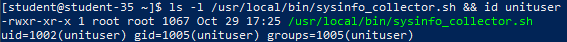
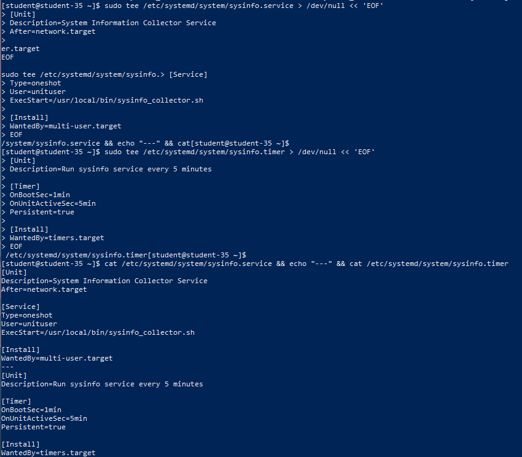
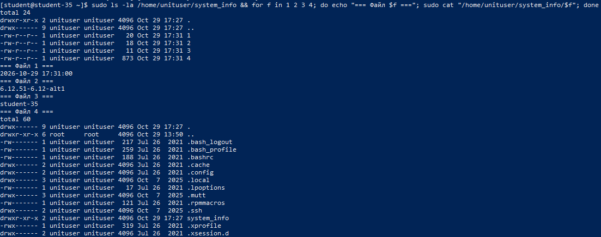
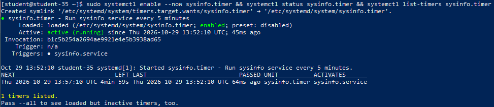
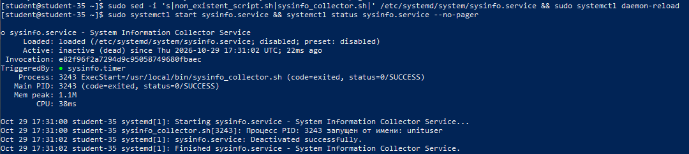
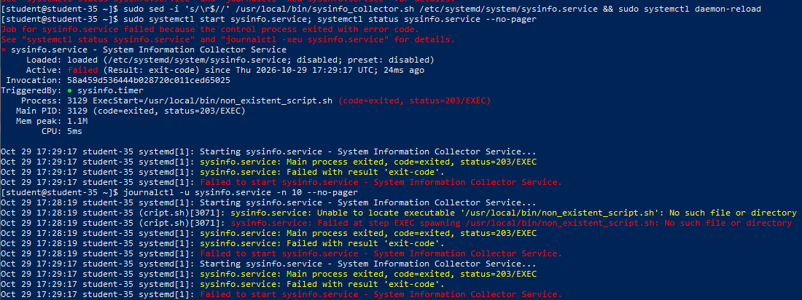

# Решение задач

## 1. Скрипт сбора системной информации `sysinfo_collector.sh`

Скрипт проверяет наличие рабочего каталога в домашней директории текущего пользователя (`$HOME/system_info`), создаёт четыре файла с именами `1`, `2`, `3`, `4` и наполняет их соответствующими системными метриками. Команда `cd "$HOME"` обеспечивает независимость от каталога, из которого запущен сервис.

```bash
#!/bin/bash
set -euo pipefail

# Переход в домашний каталог пользователя, от имени которого запущен скрипт
cd "$HOME"
TARGET_DIR="$HOME/system_info"

# Проверка существования каталога и его создание
if [ ! -d "$TARGET_DIR" ]; then
    mkdir -p "$TARGET_DIR"
    echo "Создан каталог $TARGET_DIR"
fi

# 1: Текущая дата
date '+%Y-%m-%d %H:%M:%S' > "$TARGET_DIR/1"

# 2: Версия ядра Linux
uname -r > "$TARGET_DIR/2"

# 3: Сетевое имя компьютера (hostname)
hostname > "$TARGET_DIR/3"

# 4: Список файлов домашнего каталога пользователя
ls -la "$HOME" > "$TARGET_DIR/4"

# Фиксация PID и пауза для возможности мониторинга процесса
echo "Процесс PID: $$ запущен от имени пользователя: $(whoami)"
sleep 5

echo "Сбор системных данных успешно завершён."
exit 0
```

## 2. Создание системного пользователя и размещение скрипта

По умолчанию системные службы systemd выполняются от привилегированного пользователя `root`. Для обеспечения принципа наименьших привилегий создан выделенный непривилегированный пользователь `unituser` с собственным домашним каталогом `/home/unituser`.

Скрипт сохранён по пути `/usr/local/bin/sysinfo_collector.sh` и наделён правами на исполнение (`chmod +x`).

```shell
sudo useradd -m -s /bin/bash unituser
sudo chmod +x /usr/local/bin/sysinfo_collector.sh
ls -l /usr/local/bin/sysinfo_collector.sh
id unituser
```



## 3. Конфигурация Systemd Service и Timer Units

### Файл службы `/etc/systemd/system/sysinfo.service`

Юнит сконфигурирован с типом `Type=oneshot`, директивой `User=unituser` для запуска от имени созданного пользователя и вызовом скрипта в `ExecStart`:

```ini
[Unit]
Description=System Information Collector Service
After=network.target

[Service]
Type=oneshot
User=unituser
ExecStart=/usr/local/bin/sysinfo_collector.sh

[Install]
WantedBy=multi-user.target
```

### Файл таймера `/etc/systemd/system/sysinfo.timer`

Таймер настроен на запуск службы через 1 минуту после старта системы (`OnBootSec=1min`) и далее с интервалом в каждые 5 минут (`OnUnitActiveSec=5min`). Параметр `Persistent=true` гарантирует выполнение пропущенного запуска, если система была выключена во время запланированного интервала:

```ini
[Unit]
Description=Run sysinfo service every 5 minutes

[Timer]
OnBootSec=1min
OnUnitActiveSec=5min
Persistent=true

[Install]
WantedBy=timers.target
```

```shell
cat /etc/systemd/system/sysinfo.service
cat /etc/systemd/system/sysinfo.timer
```



## 4. Применение конфигурации, запуск сервиса и проверка файлов

После добавления новых юнитов конфигурация менеджера systemd обновляется командой `systemctl daemon-reload`. Сервис запускается вручную для первичной валидации, после чего проверяется создание каталога и содержимое файлов `1`–`4`.

```shell
sudo systemctl daemon-reload
sudo systemctl start sysinfo.service
systemctl status sysinfo.service
sudo ls -la /home/unituser/system_info
for f in 1 2 3 4; do sudo cat "/home/unituser/system_info/$f"; done
```



Сервис успешно перешёл в состояние `active (exited)` с кодом `status=0/SUCCESS`. В каталоге `/home/unituser/system_info` сформированы файлы с датой, версией ядра, именем хоста и содержимым домашней папки `unituser`.

## 5. Активация таймера и проверка расписания

Таймер активируется и добавляется в автозагрузку единой командой `systemctl enable --now sysinfo.timer`.

```shell
sudo systemctl enable --now sysinfo.timer
systemctl status sysinfo.timer
systemctl list-timers sysinfo.timer
```



Вывод команды `systemctl list-timers` подтверждает, что таймер `sysinfo.timer` находится в активном состоянии (`waiting`) и запланирован к следующему срабатыванию через 5 минут для активации `sysinfo.service`.

## 6. Просмотр записей журнала и определение PID

Логирование выполнения службы фиксируется в системном журнале `journald`.

```shell
journalctl -u sysinfo.service -n 15 --no-pager
```



В выводе журнала чётко зафиксированы:

- Время запуска службы демоном systemd.
- Сообщение скрипта с выводом PID запущенного процесса (`Процесс PID: ...`).
- Пользователь, от которого выполнялся скрипт (`unituser`).
- Успешный код завершения работы (`Deactivated successfully`).

## 7. Моделирование ошибки, состояние `failed` и диагностика

В unit-файл `/etc/systemd/system/sysinfo.service` намеренно внесена ошибка: параметр `ExecStart` изменён на несуществующий бинарный путь `/usr/local/bin/non_existent_script.sh`.

```shell
sudo sed -i 's|/usr/local/bin/sysinfo_collector.sh|/usr/local/bin/non_existent_script.sh|' /etc/systemd/system/sysinfo.service
sudo systemctl daemon-reload
sudo systemctl start sysinfo.service
systemctl status sysinfo.service --no-pager
journalctl -u sysinfo.service -n 5 --no-pager
```



Служба перешла в аварийное состояние `Active: failed (Result: exit-code)`.
Причина сбоя точно локализована через `systemctl status` и `journalctl`: ошибка `status=203/EXEC` (код ошибки 203 systemd означает невозможность обнаружить или запустить указанный исполняемый файл: `No such file or directory`).

## 8. Устранение ошибки и подтверждение восстановления

Корректный путь `/usr/local/bin/sysinfo_collector.sh` восстановлен, выполнена перезагрузка конфигурации `daemon-reload` и повторный запуск.

```shell
sudo sed -i 's|/usr/local/bin/non_existent_script.sh|/usr/local/bin/sysinfo_collector.sh|' /etc/systemd/system/sysinfo.service
sudo systemctl daemon-reload
sudo systemctl start sysinfo.service
systemctl status sysinfo.service --no-pager
```


Служба вернулась в штатное рабочее состояние `active (exited)` без ошибок.
