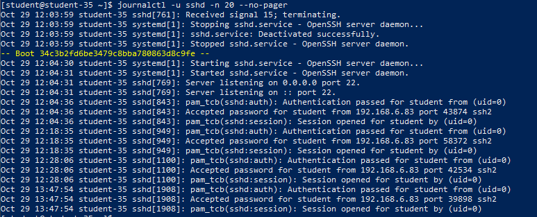
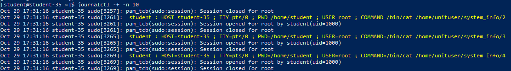
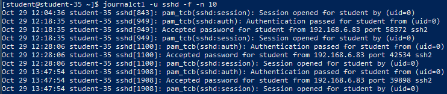
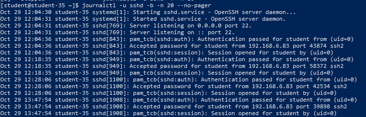
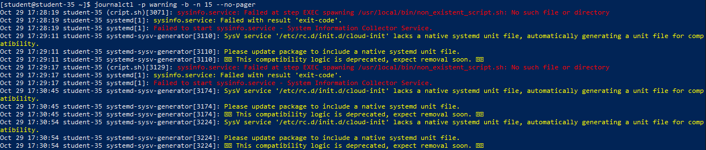
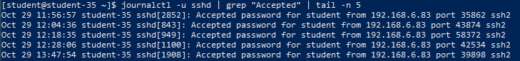

# Решение задач

## 1. Просмотр журнала службы SSH

Для просмотра событий службы OpenSSH используется утилита `journalctl` с фильтрацией по имени системного юнита `sshd.service`:

```shell
journalctl -u sshd -n 20 --no-pager
```



Команда отображает хронологический список сообщений демона `sshd`: запуск службы, привязку к сокету и входящие сессионные подключения.

## 2. Мониторинг системного журнала в реальном времени

Ключ `-f` (`--follow`) переводит `journalctl` в режим непрерывного отслеживания новых сообщений аналогично классической команде `tail -f`:

```shell
journalctl -f -n 10
```



Утилита выводит 10 последних системных записей и ожидает поступления новых событий от ядра и демонов.

## 3. Мониторинг журнала службы SSH в реальном времени

Комбинация флагов `-u sshd` и `-f` обеспечивает непрерывный поток событий исключительно для службы удалённого доступа:

```shell
journalctl -u sshd -f -n 10
```



В этом режиме на экран мгновенно поступают события попыток входа, успешных аутентификаций и отключений сессий SSH.

## 4. Фильтрация журнала SSH за текущую загрузку системы

Ключ `-b` (`--boot`) ограничивает выборку событий сессией текущей загрузки ядра ОС (исключая сообщения предыдущих перезагрузок):

```shell
journalctl -u sshd -b -n 20 --no-pager
```



Вывод содержит логи демона `sshd`, сгенерированные исключительно с момента последнего включения машины.

## 5. Фильтрация сообщений по уровню важности `warning` и выше

Ключ `-p` (`--priority`) позволяет фильтровать логи по стандартной шкале приоритетов syslog (от `emerg` до `debug`). Указание `-p warning` (или числового эквивалента `4`) отображает события уровней `emerg` (0), `alert` (1), `crit` (2), `err` (3) и `warning` (4):

```shell
journalctl -p warning -b -n 15 --no-pager
```



В выборку попадают только существенные системные предупреждения, ошибки инициализации модулей ядра и отказы сервисов.

## 6. Механизм хранения данных Journald и отличие от текстовых логов

### Где хранятся данные

Демон `systemd-journald` сохраняет журналы в специализированном бинарном формате:

- `/run/log/journal/<machine-id>/`: энергозависимое хранилище в ОЗУ (содержимое сбрасывается при перезагрузке, если постоянное хранилище не сконфигурировано).
- `/var/log/journal/<machine-id>/`: постоянное дисковое хранилище (файлы с расширением `system.journal` и `user-*.journal`).

### Доступ без команды `journalctl`

Прямой доступ возможен следующими способами:

- Программным путём через официальный API библиотеки `libsystemd` (например, на Python через модуль `systemd.journal`).
- Перенаправлением потоков `systemd-journald` в традиционные текстовые демоны логирования (`rsyslog`, `syslog-ng`) через сокет `/run/systemd/journal/syslog`.
- Базовым анализом бинарных файлов утилитами низкоуровневого дампа (`strings /var/log/journal/.../system.journal`).

### Почему `journald` не использует обычный текстовый формат

Текстовые файлы (`/var/log/syslog`) имеют существенные ограничения при работе в высоконагруженных и распределённых системах. Бинарный формат journald предоставляет ключевые преимущества:

- **Структурированные метаданные**: каждая запись представляет собой набор строго типизированных пар ключ-значение (`_PID`, `_UID`, `_GID`, `_SYSTEMD_UNIT`, `_COMM`, `_HOSTNAME`, `MESSAGE`), автоматически собираемых доверенным ядром Linux без возможности подделки со стороны процесса.
- **Индексирование и скорость**: журналы имеют встроенные B-деревья и хэш-таблицы, что обеспечивает мгновенную фильтрацию по PID, дате или сервису без полного линейного сканирования терабайтных текстовых файлов.
- **Встроенное сжатие данных**: журнальные блоки сжимаются алгоритмами `zstd` / `lz4` на лету, что экономит до 70–80% дискового пространства.
- **Контроль целостности (FSS, Forward Secure Sealing)**: поддержка криптографической защиты от модификации прошлых логов при компрометации системы злоумышленником.

## 7. Поиск собственного подключения по SSH

События успешной аутентификации пользователей в OpenSSH содержат маркер `Accepted` с указанием метода авторизации, имени пользователя, IP-адреса и порта клиента.

```shell
journalctl -u sshd | grep "Accepted" | tail -n 5
```



В найденных записях зафиксировано собственное подключение пользователя `student` с IP-адреса хоста через парольную или открытую ключевую аутентификацию:
`Accepted password for student from 192.168.6.83 port ... ssh2`.

## 8. Математический контрольный вопрос

$$2 - 2 = 0$$

Результат вычитания двух одинаковых вещественных или целых чисел тождественно равен нулю (`0`).
