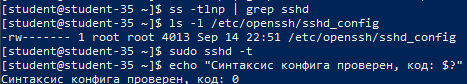
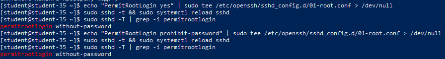
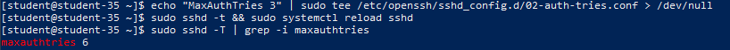
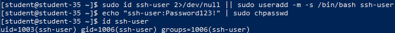
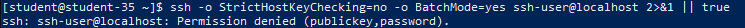
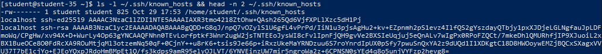

# Решение задач

## 1. Порт по умолчанию и служба SSH

По умолчанию протокол SSH использует стандартный транспортный сетевой TCP-порт `22`.

Службой, обеспечивающей приём, шифрование и обработку входящих сессий удалённого доступа, является демон OpenSSH — `sshd.service` (OpenSSH server daemon).

Для изменения рабочего порта в конфигурационном файле задаётся директива `Port <номер_порта>` (например, `Port 2222`), после чего проверяется корректность синтаксиса и перезагружается служба.

## 2. Конфигурационные файлы SSH-сервера и проверка синтаксиса

В операционных системах ALT Linux мастер-конфигурация сервера располагается по пути:

- Главный конфигурационный файл: `/etc/openssh/sshd_config`.
- Каталог для модульных конфигурационных вставок: `/etc/openssh/sshd_config.d/*.conf`.

Перед перезапуском службы конфигурация валидируется утилитой `sshd -t`. Отсутствие сообщений об ошибках и нулевой код возврата подтверждают целостность настроек.

```shell
ss -tlnp | grep sshd
ls -l /etc/openssh/sshd_config
sudo sshd -t
echo "Синтаксис конфига проверен, код: $?"
```



## 3. Настройка входа под пользователем `root`

Вход суперпользователя `root` напрямую по SSH крайне нежелателен в производственных средах по следующим причинам:

- `root` — единая известная учётная запись во всех Linux-системах, служащая первоочередной мишенью для автоматизированных атак перебора паролей (Brute-force).
- Прямой вход `root` лишает систему персонализированного аудита: в логах невозможно определить, какой именно системный администратор выполнил деструктивную команду. Безопасная модель предполагает авторизацию под личной учётной записью (`student`) с последующим повышением привилегий через `sudo`.

Для временного разрешения входа устанавливается директива `PermitRootLogin yes`. После тестирования возвращается безопасный режим `prohibit-password` (разрешён только вход по криптографическим ключам, парольный доступ заблокирован):

```shell
echo "PermitRootLogin yes" | sudo tee /etc/openssh/sshd_config.d/01-root.conf > /dev/null
sudo sshd -t && sudo systemctl reload sshd
sudo sshd -T | grep -i permitrootlogin

echo "PermitRootLogin prohibit-password" | sudo tee /etc/openssh/sshd_config.d/01-root.conf > /dev/null
sudo sshd -t && sudo systemctl reload sshd
sudo sshd -T | grep -i permitrootlogin
```



## 4. Ограничение количества попыток аутентификации

Директива `MaxAuthTries` задаёт максимальное количество попыток ввода неверных учётных данных за одну сессию до принудительного разрыва TCP-соединения сервером. Ограничение в `3` попытки предотвращает атаки подбора:

```shell
echo "MaxAuthTries 3" | sudo tee /etc/openssh/sshd_config.d/02-auth-tries.conf > /dev/null
sudo sshd -t && sudo systemctl reload sshd
sudo sshd -T | grep -i maxauthtries
```



Команда `sshd -T` выводит фактическую итоговую конфигурацию демона, подтверждая активное значение `maxauthtries 3`.

## 5. Создание пользователя `ssh-user`

Создание системной учётной записи с собственной домашней директорией и командной оболочкой:

```shell
sudo useradd -m -s /bin/bash ssh-user
echo "ssh-user:Password123!" | sudo chpasswd
id ssh-user
```



## 6. Ограничение доступа для `ssh-user`

Для избирательного запрета подключения конкретных пользователей OpenSSH предоставляет директиву `DenyUsers`. При наличии имени пользователя в списке `DenyUsers` сервер отвергает любые попытки аутентификации ещё до этапа проверки пароля или ключа:

```shell
echo "DenyUsers ssh-user" | sudo tee /etc/openssh/sshd_config.d/03-deny-user.conf > /dev/null
sudo sshd -t && sudo systemctl reload sshd
ssh -o BatchMode=yes ssh-user@localhost 2>&1 || true
```



При попытке подключения сервер мгновенно возвращает отказ доступа (`Permission denied`), предотвращая вход пользователя `ssh-user`.

## 7. Назначение файла `known_hosts` и поиск ключа хоста

Файл `~/.ssh/known_hosts` на клиенте хранит базу данных публичных ключей (отпечатков) всех удалённых SSH-серверов, к которым когда-либо производилось подключение.

Основное назначение `known_hosts` — защита от атак типа «человек посередине» (Man-in-the-Middle, MITM). Если злоумышленник попытается перехватить трафик или подменить IP-адрес сервера, клиент обнаружит несовпадение предъявленного ключа с сохранённым в `known_hosts` и заблокирует сессию с предупреждением `REMOTE HOST IDENTIFICATION HAS CHANGED!`.

```shell
ls -l ~/.ssh/known_hosts
head -n 2 ~/.ssh/known_hosts
```


