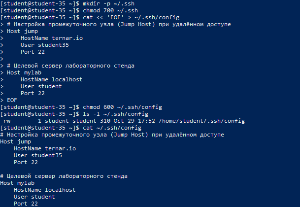
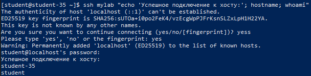

# Решение задач

## 1. Хранение настроек SSH-клиента

Конфигурационные параметры клиентской части OpenSSH разделяются на два уровня:

- **Пользовательский уровень**: файл `~/.ssh/config`. Имеет наивысший приоритет, настраивается индивидуально каждым пользователем и защищается правами доступа `600` (`chmod 600 ~/.ssh/config`).
- **Общесистемный уровень**: файл `/etc/openssh/ssh_config` (в ряде дистрибутивов доступен как `/etc/ssh/ssh_config`). Задаёт глобальные параметры по умолчанию для всех пользователей операционной системы.

## 2. Настройка файла `~/.ssh/config` и поддержка ProxyJump

Для устранения необходимости ввода длинных команд со всеми ключами (`ssh -p 22 student@192.168.6.135`) в файле `~/.ssh/config` описываются секции `Host` с псевдонимами.

В конфигурации определены:

- Блок `jump`: параметры промежуточного шлюза (`ternar.io`) для перенаправления трафика.
- Блок `mylab`: целевой сервер со всеми атрибутами подключения (`HostName`, `User`, `Port`).

```shell
mkdir -p ~/.ssh
chmod 700 ~/.ssh

cat << 'EOF' > ~/.ssh/config
# Настройка промежуточного узла (Jump Host) при удалённом доступе
Host jump
    HostName ternar.io
    User student35
    Port 22

# Целевой сервер лабораторного стенда
Host mylab
    HostName localhost
    User student
    Port 22
EOF

chmod 600 ~/.ssh/config
ls -l ~/.ssh/config
cat ~/.ssh/config
```



### Назначение директив блока `Host`

- `Host`: задаёт удобный короткий псевдоним (алиас), используемый в командной строке (`ssh mylab`).
- `HostName`: реальный IP-адрес или доменное имя удалённого сервера.
- `User`: логин учётной записи на целевом сервере.
- `Port`: номер TCP-порта службы OpenSSH.
- `ProxyJump`: директива прозрачной туннелизации через указанный jump-хост.

## 3. Проверка подключения по псевдониму

Подключение выполняется короткой командой без явного указания хоста, пользователя и порта:

```shell
ssh mylab "echo 'Успешное подключение к хосту:'; hostname; whoami"
```



Клиент SSH автоматически извлёк параметры из `~/.ssh/config`, успешно установил сессию и выполнил тестовую команду под пользователем `student`.
