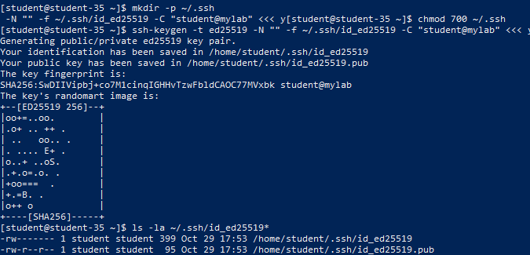
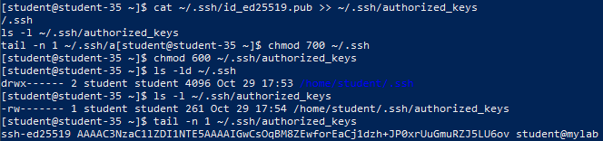
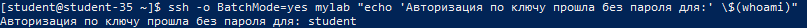
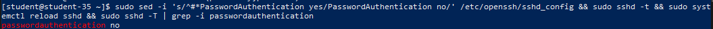
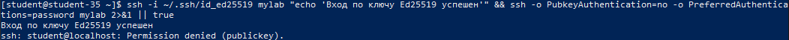

# Решение задач

## 1. Понятие SSH-ключей и преимущества перед паролями

Аутентификация по SSH-ключам базируется на принципах асимметричной криптографии и использует связку из двух математически связанных ключей:

- **Приватный (секретный) ключ**: генерируется на стороне клиента, хранится в тайне, защищается правами доступа `600` и никогда не передаётся по сети или третьим лицам.
- **Публичный (открытый) ключ**: свободно размещается на серверах, к которым требуется доступ, в файле доверенных ключей `~/.ssh/authorized_keys`.

При попытке входа сервер шифрует случайную последовательность (челлендж) открытым ключом пользователя, а клиент расшифровывает её своим закрытым ключом и отправляет цифровую подпись. Это обеспечивает ключевые преимущества:

- Неуязвимость к перебору (brute-force) и словарным атакам.
- Защиту от перехвата учётных данных на недоверенных промежуточных узлах.
- Возможность надёжной автоматизации скриптов и CI/CD процессов без хранения открытых паролей.

Передача приватного ключа третьим лицам категорически недопустима, поскольку любой обладатель приватного ключа получает полный доступ к целевым системам от имени владельца ключа с невозможностью разграничить легитимные и скомпрометированные сессии.

## 2. Генерация пары ключей по алгоритму Ed25519

Алгоритм `Ed25519` (эллиптическая кривая Curve25519) обеспечивает повышенную криптографическую стойкость при минимальной длине ключа и наивысшей скорости вычислений по сравнению с устаревающим RSA.

```shell
mkdir -p ~/.ssh
chmod 700 ~/.ssh
ssh-keygen -t ed25519 -N "" -f ~/.ssh/id_ed25519 -C "student@mylab" <<< y
ls -la ~/.ssh/id_ed25519*
```



Сгенерированы два файла:

- Приватный ключ: `~/.ssh/id_ed25519` (права `-rw-------`, `600`).
- Публичный ключ: `~/.ssh/id_ed25519.pub` (права `-rw-r--r--`, `644`).

## 3. Размещение открытого ключа и настройка прав доступа

Для предоставления доступа публичный ключ добавляется в файл доверенных ключей `~/.ssh/authorized_keys` на целевом сервере (вручную либо утилитой `ssh-copy-id`).

Служба OpenSSH реализует механизм строгой проверки прав доступа (StrictModes): если директория `~/.ssh` или файл `authorized_keys` доступны для записи другим пользователям группы или системы, сервер в целях безопасности блокирует вход.

```shell
cat ~/.ssh/id_ed25519.pub >> ~/.ssh/authorized_keys
chmod 700 ~/.ssh
chmod 600 ~/.ssh/authorized_keys
ls -ld ~/.ssh
ls -l ~/.ssh/authorized_keys
tail -n 1 ~/.ssh/authorized_keys
```



Установлены эталонные права:

- Каталог `~/.ssh`: `drwx------` (`700`, только владелец).
- Файл `~/.ssh/authorized_keys`: `-rw-------` (`600`, только чтение/запись владельцем).

## 4. Проверка беспарольного подключения по ключу

```shell
ssh -o BatchMode=yes mylab "echo 'Авторизация по ключу прошла без пароля для:' \$(whoami)"
```



Параметр `BatchMode=yes` отключает интерактивные запросы ввода пароля. Успешный вывод подтверждает, что аутентификация выполнена исключительно по криптографическому ключу Ed25519.

## 5. Полное отключение парольной аутентификации на сервере

Для исключения атак подбора паролей в конфигурацию SSH-сервера вносится директива `PasswordAuthentication no`.

```shell
echo "PasswordAuthentication no" | sudo tee /etc/openssh/sshd_config.d/04-no-password.conf > /dev/null
sudo sshd -t && sudo systemctl reload sshd
sudo sshd -T | grep -i passwordauthentication
```



Вывод команды `sshd -T` подтверждает активный параметр `passwordauthentication no`.

## 6. Валидация политик аутентификации

### Вход по ключу

```shell
ssh -i ~/.ssh/id_ed25519 mylab "echo 'Вход по ключу Ed25519 работает штатно!'"
```

Сессия открывается мгновенно и без запроса паролей.

### Попытка парольного входа

Для эмуляции клиента без ключа передаются опции отключения открытых ключей `-o PubkeyAuthentication=no` и принудительного использования пароля `-o PreferredAuthentications=password`:

```shell
ssh -o PubkeyAuthentication=no -o PreferredAuthentications=password mylab 2>&1 || true
```



Сервер отвергает попытку соединения с ошибкой `Permission denied (publickey)`, подтверждая, что неавторизованные пользователи без криптографического ключа не смогут подключиться к системе.
