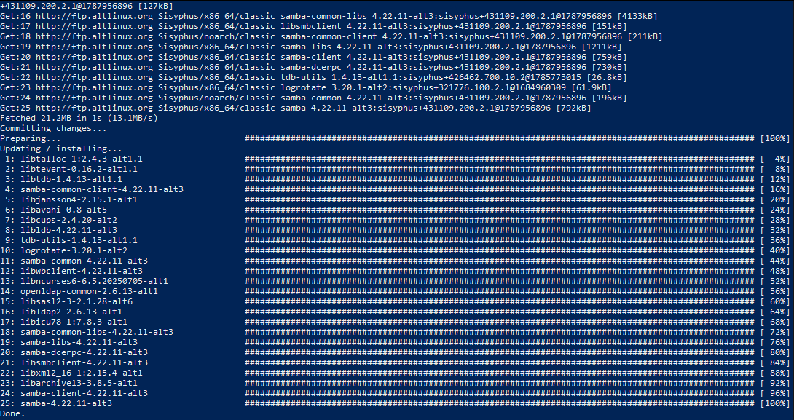
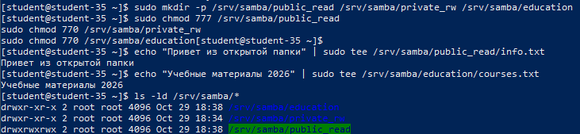
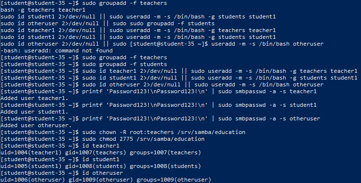
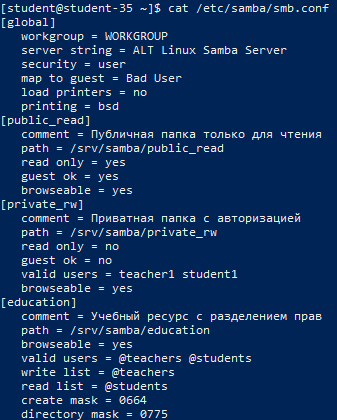
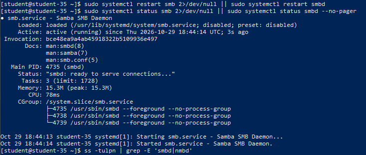
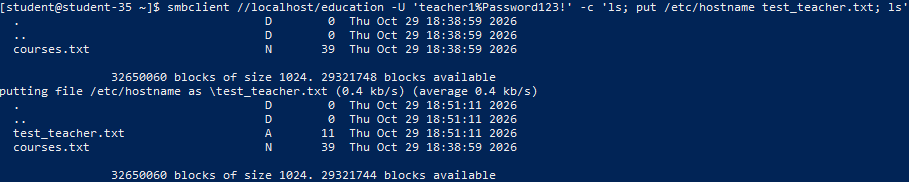
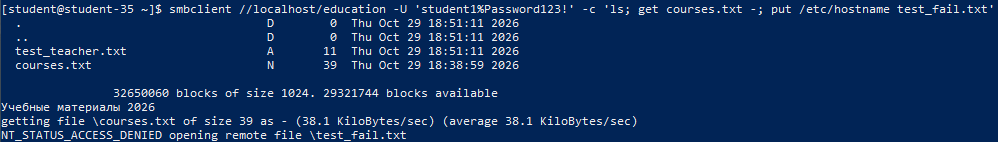
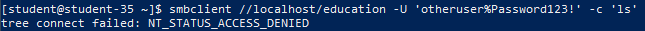
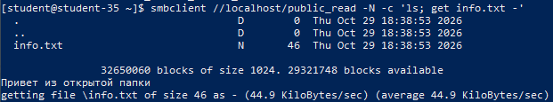

# Решение задач

## 1. Установка пакетов Samba и клиентских утилит

Пакет Samba реализует стек сетевых протоколов SMB/CIFS в Unix-подобных операционных системах, предоставляя сервисы файлового сервера и авторизации для гетерогенных сетей (Windows, Linux, macOS).

```shell
sudo apt-get update && sudo apt-get install -y samba samba-client
smbd -V
smbclient -V
```



Установлены демон файлового сервера `smbd` и клиентская диагностическая утилита `smbclient`.

## 2. Понятие общего сетевого ресурса и сценарии применения

**Общий сетевой ресурс (сетевая папка, SMB Share)** — это каталог файловой системы хоста, опубликованный по сети с помощью сетевого протокола прикладного уровня (Server Message Block / CIFS) с настраиваемыми политиками аутентификации и разграничения прав доступа.

Сетевые ресурсы необходимы для:

- Централизованного корпоративного хранения документов и мультимедийных файлов.
- Организации совместной работы пользователей в разнородных инфраструктурах (интероперабельность Windows и Linux).
- Безопасного разграничения доступа на основе членства в группах пользователей.
- Хранения резервных копий систем и конфигураций сетевого оборудования.

## 3. Создание каталогов и настройка прав доступа файловой системы

Каталоги сетевых ресурсов созданы в системной иерархии `/srv/samba/`:

- `/srv/samba/public_read` — общедоступный ресурс без авторизации, права `777` (ограничение записи регулируется на уровне конфигурации Samba).
- `/srv/samba/private_rw` — защищённый ресурс для авторизованных пользователей.
- `/srv/samba/education` — учебный ресурс с совместным доступом групп. Каталог закреплён за группой `teachers` с установкой SGID-бита (`chmod 2775`), благодаря чему все вновь создаваемые внутри файлы автоматически наследуют группу `teachers`.

```shell
sudo mkdir -p /srv/samba/public_read /srv/samba/private_rw /srv/samba/education
sudo chmod 777 /srv/samba/public_read
sudo chmod 770 /srv/samba/private_rw
sudo chmod 770 /srv/samba/education
echo "Привет из открытой папки" | sudo tee /srv/samba/public_read/info.txt
echo "Учебные материалы 2026" | sudo tee /srv/samba/education/courses.txt
ls -ld /srv/samba/*
```



## 4. Создание групп и пользователей, инициализация базы Samba

Созданы группы `teachers` и `students`, а также трое тестовых пользователей:

- `teacher1` (состоит в группе `teachers`).
- `student1` (состоит в группе `students`).
- `otheruser` (не входит в учебные группы).

Для каждого пользователя задан пароль в базе учетных записей Samba с помощью команды `smbpasswd -a`.

```shell
sudo groupadd -f teachers
sudo groupadd -f students
sudo useradd -m -s /bin/bash -g teachers teacher1
sudo useradd -m -s /bin/bash -g students student1
sudo useradd -m -s /bin/bash otheruser

printf 'Password123!\nPassword123!\n' | sudo smbpasswd -a -s teacher1
printf 'Password123!\nPassword123!\n' | sudo smbpasswd -a -s student1
printf 'Password123!\nPassword123!\n' | sudo smbpasswd -a -s otheruser

sudo chown -R root:teachers /srv/samba/education
sudo chmod 2775 /srv/samba/education
id teacher1
id student1
id otheruser
```



## 5. Конфигурация `/etc/samba/smb.conf`

Файл `/etc/samba/smb.conf` сконфигурирован для публикации трёх ресурсов:

- `[public_read]`: общедоступный ресурс без пароля (`guest ok = yes`, `read only = yes`).
- `[private_rw]`: ресурс с обязательной аутентификацией и правами на запись (`valid users = teacher1 student1`, `read only = no`).
- `[education]`: ресурс с дифференцированными правами. Директива `valid users = @teachers @students` ограничивает круг допущенных групп. Директива `write list = @teachers` наделяет преподавателей полными правами записи, а директива `read list = @students` гарантирует студентам режим «только чтение».

Проверка содержимого конфигурационного файла:

```shell
cat /etc/samba/smb.conf
```



## 6. Запуск службы и мониторинг сетевых портов

```shell
sudo systemctl restart smb 2>/dev/null || sudo systemctl restart smbd
ss -tulpn | grep -E 'smbd|nmbd'
```



Служба Samba прослушивает следующие сетевые порты:

- **TCP 445 (microsoft-ds)**: основной современный порт SMB-over-TCP для передачи файлов без использования NetBIOS.
- **TCP 139 (netbios-ssn)**: служба сеансов NetBIOS Session Service.
- **UDP 137 (netbios-ns)**: служба имён NetBIOS Name Service.
- **UDP 138 (netbios-dgm)**: служба дейтаграмм NetBIOS Datagram Service.

## 7. Проверка доступа от пользователя с полными правами (`teacher1`)

Проверка выполняется через клиентскую утилиту `smbclient`. Пользователь `teacher1` входит на ресурс `education`, успешно просматривает каталог (`ls`) и записывает новый файл `test_teacher.txt` (`put`):

```shell
smbclient //localhost/education -U 'teacher1%Password123!' -c 'ls; put /etc/hostname test_teacher.txt; ls'
```



Файл `test_teacher.txt` успешно загружен и отображается в листинге каталога.

## 8. Проверка доступа от пользователя с правами только на чтение (`student1`)

Пользователь `student1` входит на ресурс `education`, успешно считывает существующий файл `courses.txt` (`get`), однако при попытке записи файла `test_fail.txt` сервер отклоняет операцию:

```shell
smbclient //localhost/education -U 'student1%Password123!' -c 'ls; get courses.txt -; put /etc/hostname test_fail.txt'
```



Вывод команды фиксирует сообщение `NT_STATUS_ACCESS_DENIED`, подтверждая строгое применение директивы `read list = @students`.

## 9. Проверка блокировки доступа для неавторизованного пользователя (`otheruser`)

Пользователь `otheruser`, не входящий ни в группу `teachers`, ни в группу `students`, предпринимает попытку подключения к ресурсу `education`:

```shell
smbclient //localhost/education -U "otheruser%Password123!" -c 'ls' 2>&1 || true
```



Сервер Samba немедленно блокирует подключение с ошибкой `tree connect failed: NT_STATUS_ACCESS_DENIED`, подтверждая полную изоляцию ресурса от посторонних пользователей.

## 10. Проверка гостевого ресурса без пароля (`public_read`)

Гостевое подключение выполняется с флагом `-N` (без запроса пароля). Клиент успешно просматривает каталог и читает файл `info.txt`:

```shell
smbclient //localhost/public_read -N -c 'ls; get info.txt -'
```


