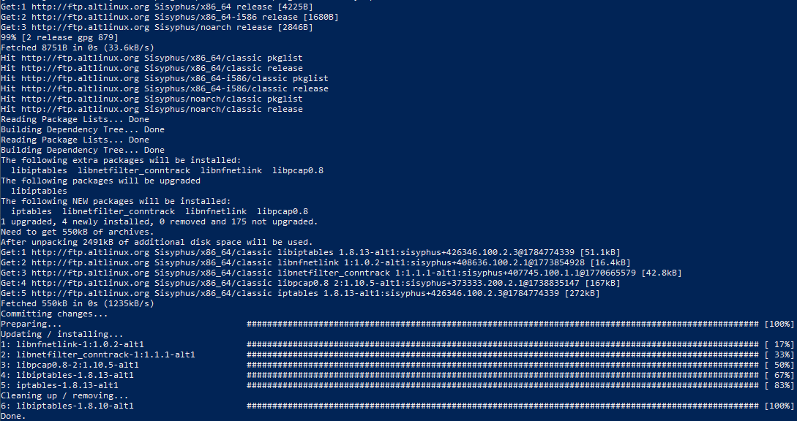
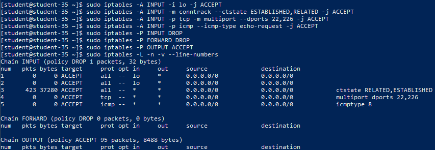
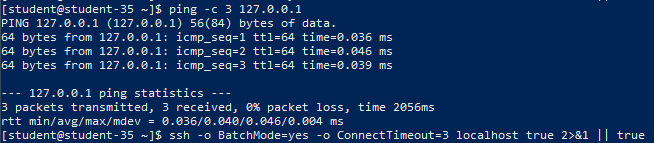
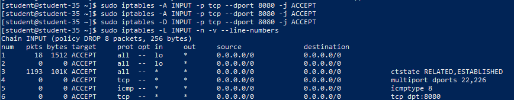
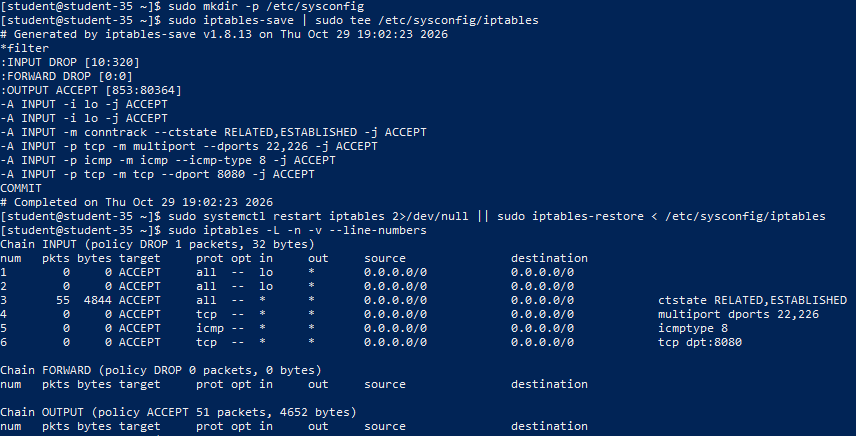

# Решение задач

## 1. Установка iptables и исходное состояние правил фильтрации

В современных дистрибутивах Linux (включая ALT Linux) утилита `iptables` выступает интерфейсом конфигурации пакетного фильтра ядра Netfilter.

```shell
sudo apt-get update && sudo apt-get install -y iptables
sudo iptables -L -n -v --line-numbers
```



В исходном состоянии все стандартные цепочки таблицы `filter` (`INPUT`, `FORWARD`, `OUTPUT`) имеют политику по умолчанию `ACCEPT`, а пользовательские правила отсутствуют.

## 2. Настройка правил межсетевого экрана и политик безопасности

Для обеспечения безопасной работы хоста сформирован набор правил:

1. **Loopback-интерфейс (`lo`)**: разрешён весь входящий локальный трафик, необходимый для взаимодействия системных демонов и межпроцессного взаимодействия (`IPC`).
2. **Отслеживание состояний (`conntrack`)**: разрешены пакеты для установленных (`ESTABLISHED`) и связанных (`RELATED`) сессий, что предотвращает разрыв текущей SSH-сессии при смене политики.
3. **Входящий SSH**: разрешён входящий трафик по порту TCP 22 (а также 226 при нестандартном порте подключения).
4. **ICMP Echo-Request**: разрешена обработка входящих запросов утилиты `ping` для базовой сетевой диагностики хоста.
5. **Запрет неразрешённого входящего трафика**: для цепочек `INPUT` и `FORWARD` установлена политика `DROP`.

```shell
sudo iptables -A INPUT -i lo -j ACCEPT
sudo iptables -A INPUT -m conntrack --ctstate ESTABLISHED,RELATED -j ACCEPT
sudo iptables -A INPUT -p tcp -m multiport --dports 22,226 -j ACCEPT
sudo iptables -A INPUT -p icmp --icmp-type echo-request -j ACCEPT
sudo iptables -P INPUT DROP
sudo iptables -P FORWARD DROP
sudo iptables -P OUTPUT ACCEPT

sudo iptables -L -n -v --line-numbers
```



Итоговый листинг подтверждает корректный порядок следования правил: разрешающие правила расположены в начале цепочки, а весь остальной трафик отбрасывается политикой `DROP`.

## 3. Транспортный протокол SSH и проверка подключения

SSH использует транспортный протокол **TCP** (обычно порт 22). Протокол TCP гарантирует надёжную доставку пакетов, упорядоченность потока байтов и контроль целостности сессии с помощью механизма подтверждений (ACK) и трёхэтапного рукопожатия (3-way handshake).

Работоспособность правил проверяется выполнением запроса ping и обращением к порту SSH:

```shell
ping -c 3 127.0.0.1
ssh -o BatchMode=yes -o ConnectTimeout=3 localhost true 2>&1 || true
```



Сетевой стек хоста корректно отвечает на ICMP-запросы и удерживает соединение по протоколу SSH.

## 4. Временное открытие дополнительного TCP-порта и его удаление

Для демонстрации динамического управления правилами открыт порт TCP 8080 (например, веб-сервис), выполнена проверка таблицы правил и произведено последующее удаление правила:

```shell
sudo iptables -A INPUT -p tcp --dport 8080 -j ACCEPT
sudo iptables -L INPUT -n -v --line-numbers
sudo iptables -D INPUT -p tcp --dport 8080 -j ACCEPT
sudo iptables -L INPUT -n -v --line-numbers
```



Правило появилось в конце цепочки `INPUT` с порядковым номером, а после выполнения команды `iptables -D` было корректно удалено без влияния на остальные записи.

## 5. Постоянное сохранение правил межсетевого экрана

Правила `iptables` не сохраняются после перезагрузки автоматически, поскольку они хранятся непосредственно в структурах оперативной памяти подсистемы Netfilter ядра Linux.

Для долговременного сохранения конфигурации в ALT Linux используется дамп правил в файл `/etc/sysconfig/iptables`, считываемый системной службой при старте ОС:

```shell
sudo mkdir -p /etc/sysconfig
sudo iptables-save | sudo tee /etc/sysconfig/iptables
sudo systemctl restart iptables 2>/dev/null || sudo iptables-restore < /etc/sysconfig/iptables
sudo iptables -L -n -v --line-numbers
```



Листинг после перезапуска подтверждает, что сохранённые правила успешно восстанавливаются из файла конфигурации.
