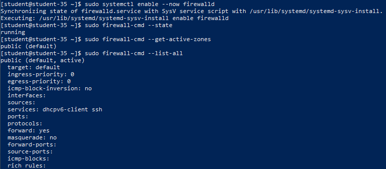
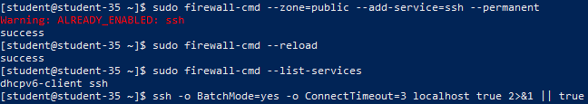
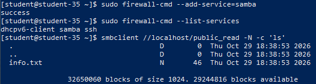
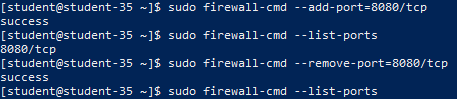
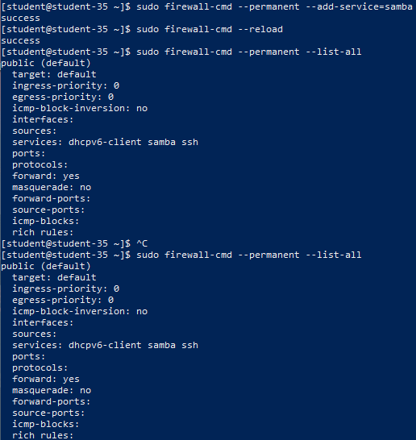
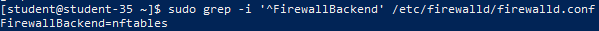

# Решение задач

## 1. Установка и запуск firewalld, определение активной зоны и интерфейсов

`firewalld` представляет собой динамический межсетевой экран с поддержкой сетевых зон доверия (zones) и абстракций сервисов (services). Перед его активацией сбрасываются статические правила `iptables`, чтобы исключить конфликт фильтрации.

```shell
sudo systemctl stop iptables 2>/dev/null || true
sudo iptables -F 2>/dev/null || true
sudo iptables -P INPUT ACCEPT 2>/dev/null || true
sudo apt-get update && sudo apt-get install -y firewalld
sudo systemctl enable --now firewalld
sudo firewall-cmd --state
sudo firewall-cmd --get-active-zones
sudo firewall-cmd --list-all
```



По умолчанию активной зоной является `public`, к которой привязан сетевой интерфейс системы. До внесения изменений список сервисов включает только предустановленные службы (например, `dhcpv6-client`), а порты не открыты.

## 2. Разрешение сервиса SSH и проверка доступности

Подключение по SSH проверяется через утилиту `ssh`. Для гарантированного сохранения доступа сервис `ssh` добавляется в постоянную конфигурацию зоны `public`:

```shell
sudo firewall-cmd --zone=public --add-service=ssh --permanent
sudo firewall-cmd --reload
sudo firewall-cmd --list-services
ssh -o BatchMode=yes -o ConnectTimeout=3 localhost true 2>&1 || true
```



В выводе `firewall-cmd --list-services` отображается активная служба `ssh`, а проверка подключения проходит успешно.

## 3. Добавление доступа по названию сервиса

В `firewalld` разрешено добавлять доступ не только по числовым номерам портов, но и по именованным **сервисам** (`--add-service=<name>`). Демон использует системные XML-шаблоны из каталога `/usr/lib/firewalld/services/` (или пользовательские из `/etc/firewalld/services/`), в которых заранее сопоставлены необходимые транспортные протоколы и диапазоны портов. Это упрощает администрирование комплексных протоколов.

## 4. Разрешение Samba-сервера и проверка подключения

Для взаимодействия с Samba-сервером (порты TCP 139, 445 и UDP 137, 138) в runtime-конфигурацию добавляется служба `samba`:

```shell
sudo firewall-cmd --add-service=samba
sudo firewall-cmd --list-services
smbclient //localhost/public_read -N -c 'ls'
```



Команда `smbclient` успешно получает листинг общего сетевого ресурса `public_read`, подтверждая беспрепятственное прохождение SMB-пакетов через межсетевой экран.

## 5. Добавление тестового TCP-порта по номеру и его удаление

Для демонстрации точечного проброса портов без привязки к имени сервиса открыт TCP-порт 8080:

```shell
sudo firewall-cmd --add-port=8080/tcp
sudo firewall-cmd --list-ports
sudo firewall-cmd --remove-port=8080/tcp
sudo firewall-cmd --list-ports
```



После добавления порт `8080/tcp` отобразился в выводе `--list-ports`, а затем был удалён из активных правил runtime-окружения.

## 6. Сохранение постоянной конфигурации и проверка после reload

Для долговременного сохранения параметров используется директива `--permanent` с последующей перезагрузкой правил (`--reload`):

```shell
sudo firewall-cmd --permanent --add-service=samba
sudo firewall-cmd --reload
sudo firewall-cmd --permanent --list-all
sudo firewall-cmd --list-all
```



Вывод постоянной (`--permanent`) и текущей конфигураций полностью совпадает, подтверждая сохранение служб `ssh` и `samba` после перезапуска правил.

## 7. Определение используемого backend

`firewalld` не фильтрует сетевые пакеты самостоятельно, а транслирует правила в подсистемы ядра Linux через один из поддерживаемых backend (`nftables` или `iptables`):

```shell
sudo grep -i '^FirewallBackend' /etc/firewalld/firewalld.conf
```



Значение параметра `FirewallBackend=nftables` указывает, что в качестве низкоуровневого движка фильтрации пакетов и трансляции адресов используется современная подсистема `nftables`.
