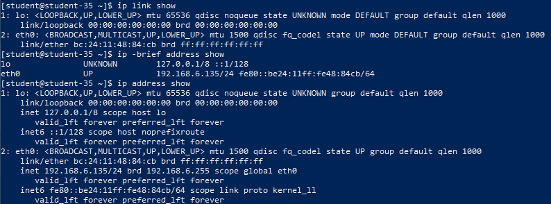
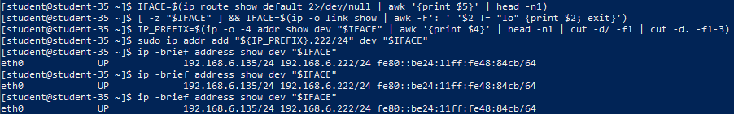
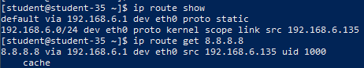
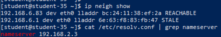
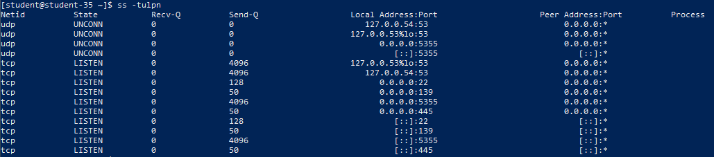
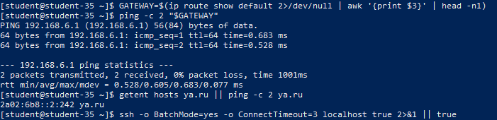

# Решение задач

## 1. Список сетевых интерфейсов, IPv4-адрес, маска и MAC-адрес

Список интерфейсов получен двумя стандартными утилитами подсистемы `iproute2`: `ip link show` (канальный уровень L2) и `ip -brief address show` (сетевой уровень L3):

```shell
ip link show
ip -brief address show
ip address show
```



В системе определены:

- **Интерфейс обратной петли (`lo`)**: адрес `127.0.0.1/8`, MAC-адрес `00:00:00:00:00:00`.
- **Основной рабочий интерфейс (`eth0`)**: активный сетевой адаптер хоста с IPv4-адресом `192.168.6.135`, маской `/24` (`255.255.255.0`), широковещательным адресом `192.168.6.255` и аппаратным MAC-адресом `bc:24:11:48:84:cb`.

## 2. Добавление и удаление дополнительного IPv4-адреса

Стек сетевых протоколов Linux поддерживает одновременное назначение нескольких IP-адресов (IP aliasing / secondary IP) на один физический интерфейс:

```shell
sudo ip addr add 192.168.6.222/24 dev eth0
ip -brief address show dev eth0
sudo ip addr del 192.168.6.222/24 dev eth0
ip -brief address show dev eth0
```



После выполнения команды `ip addr add` на сетевом интерфейсе `eth0` появился вторичный IPv4-адрес `192.168.6.222/24`, при этом основной адрес `192.168.6.135/24` остался активным. Команда `ip addr del` удаляет дополнительный адрес без разрыва существующих соединений.

## 3. Таблица маршрутизации и определение маршрута до IP-адреса

Таблица маршрутизации ядра определяет пути следования пакетов на основе IP-адреса назначения:

```shell
ip route show
ip route get 8.8.8.8
```



- **Default gateway (шлюз по умолчанию)**: запись `default via 192.168.6.1 dev eth0`, через которую направляется весь нелокальный трафик.
- **Определение маршрута до IP (8.8.8.8)**: утилита `ip route get` вычисляет конкретный интерфейс выхода (`eth0`), шлюз следующего перехода (`via 192.168.6.1`) и локальный IP-адрес источника (`src 192.168.6.135`).

## 4. Таблица ARP/neighbor, MAC-адрес шлюза и DNS-серверы

Протокол ARP (Address Resolution Protocol) динамически транслирует IP-адреса локальной сети в аппаратные MAC-адреса:

```shell
ip neigh show
cat /etc/resolv.conf | grep nameserver
```



- В выводе `ip neigh` зафиксирован IP-адрес шлюза `192.168.6.1` и соответствующий ему аппаратный MAC-адрес `6e:63:f8:83:fb:47`.
- Конфигурация системного резолвера `/etc/resolv.conf` определяет адрес сервера доменных имён: `nameserver 192.168.2.3`.

## 5. Мониторинг слушающих сетевых портов TCP и UDP

Просмотр активных сокетов выполняется с помощью утилиты `ss` с опциями `-t` (TCP), `-u` (UDP), `-l` (listening), `-p` (processes), `-n` (numeric):

```shell
ss -tulpn
```



В системе зафиксированы открытые порты системных служб (SSH по порту TCP 22/226, службы Samba по портам TCP 139, 445 и UDP 137, 138, а также локальные сокеты DNS/systemd).

## 6. Проверка сетевой связности: шлюз, DNS и SSH

Выполнены три последовательные изолированные проверки:

1. **Доступность шлюза по протоколу ICMP**: проверка прямого L2/L3-канала до первого маршрутизатора.
2. **DNS-разрешение имени**: проверка преобразования доменного имени `ya.ru` в IP-адрес через сервер имён.
3. **Соединение с SSH-сервером**: проверка работоспособности транспортного протокола TCP на порту прикладной службы.

```shell
ping -c 2 $(ip route show default | awk '{print $3}')
getent hosts ya.ru || ping -c 2 ya.ru
ssh -o BatchMode=yes -o ConnectTimeout=3 localhost true 2>&1 || true
```



Все три проверки завершены успешно: пакеты до шлюза доходят без потерь, DNS-запрос возвращает валидный адрес, сокет SSH принимает входящие подключения.

## 7. Разграничение проблем IP-связности и проблем DNS

Для оперативной диагностики неполадок сетевого стека используется пошаговый алгоритм:

- **Проблема на уровне IP-связности (L1–L3)**:
  - Пакеты `ping` не доходят до шлюза по умолчанию (`Destination Host Unreachable` или `100% packet loss`) либо не пингуется внешний публичный IP-адрес (например, `ping 8.8.8.8`).
  - Причина: физический обрыв линка, неверный IP-адрес или маска, отсутствие маршрута по умолчанию (`default gateway`), блокировка на межсетевом экране или сбой на шлюзе провайдера.
- **Проблема на уровне DNS (L7)**:
  - Прямой пинг по публичному числовому IP-адресу (`ping 8.8.8.8`) проходит успешно и без задержек, однако обращение по доменному имени (`ping ya.ru` или `curl http://example.com`) возвращает ошибку `Name or service not known` / `Could not resolve host`.
  - Причина: недоступность DNS-серверов из `/etc/resolv.conf`, блокировка исходящего UDP/TCP-порта 53, сбой в работе службы `systemd-resolved` либо неверная конфигурация зон поиска `search`/`domain`.

## 8. Теоретические ответы на контрольные вопросы

### 8) Что такое IP-адрес?

**IP-адрес (Internet Protocol Address)** — это уникальный числовой идентификатор узла (компьютера, маршрутизатора, сервера) в компьютерной сети, построенной на базе стека протоколов TCP/IP. Служит для адресации и маршрутизации пакетов на сетевом уровне модели OSI (L3).

### 9) Для чего нужны маршруты?

**Маршруты (Routes)** задают правила в таблице маршрутизации ядра, определяющие, через какой локальный сетевой интерфейс и на какой промежуточный узел (шлюз / next-hop router) должны отправляться сетевые пакеты в зависимости от подсети назначения.

### 10) Что такое ARP?

**ARP (Address Resolution Protocol)** — протокол разрешения адресов сетевого уровня в адреса канального уровня. Он преобразует известный IPv4-адрес узла назначения в соответствующий физический MAC-адрес сетевой карты для передачи кадров в пределах одного широковещательного сегмента Ethernet.

### 11) Что такое DHCP?

**DHCP (Dynamic Host Configuration Protocol)** — протокол прикладного уровня, позволяющий сетевым устройствам автоматически получать базовые параметры сетевой конфигурации: свободный IP-адрес из пула, маску подсети, адрес шлюза по умолчанию (default gateway), адреса DNS-серверов и параметры NTP.

### 12) Что такое DNS?

**DNS (Domain Name System)** — распределённая иерархическая база данных и сетевой протокол, выполняющий преобразование понятных человеку алфавитно-цифровых доменных имён (например, `ya.ru`) в числовые IP-адреса компьютеров (например, `87.250.250.242`), необходимые для сетевого взаимодействия.

### 13) Протоколы синхронизации времени

Основным протоколом синхронизации системного времени узла с эталонными серверами точного времени является **NTP (Network Time Protocol)**, а также его облегчённая версия **SNTP (Simple Network Time Protocol)** и прецизионный протокол **PTP (Precision Time Protocol, IEEE 1588)**. В современных дистрибутивах Linux синхронизацию реализуют демоны `chrony` и `systemd-timesyncd`.

### 14) Широковещательный адрес и его назначение

**Широковещательный адрес (Broadcast Address)** — специальный адрес подсети, предназначенный для одновременной рассылки сетевых пакетов абсолютно всем активным узлам в пределах данного широковещательного домена (L2/L3 сегмента). Он необходим для начального обнаружения узлов, работы протоколов ARP, DHCP и маршрутизационных анонсов.

### 15) Расчёт широковещательного адреса

Широковещательный адрес вычисляется путём побитового логического сложения (OR) IP-адреса хоста и инвертированной маски подсети (все хостовые биты устанавливаются в `1`). Для рабочей подсети хоста `192.168.6.135/24` с маской `255.255.255.0` широковещательным адресом является **`192.168.6.255`**.

### 16) Дополнительные параметры сетевого интерфейса

Помимо IP-адреса и маски, сетевому интерфейсу настраиваются:

- **MAC-адрес** (аппаратный идентификатор канального уровня L2).
- **MTU (Maximum Transmission Unit)** — максимальный размер полезного блока данных кадра (по умолчанию 1500 байт для Ethernet).
- **Speed и Duplex** — скорость передачи (100/1000/10000 Мбит/с) и режим дуплекса (Full/Half).
- **Состояние интерфейса (State)**: административное включение (`UP`) или выключение (`DOWN`).
- **txqueuelen** — длина очереди пакетов на передачу на уровне сетевого драйвера.

### 17) Что такое маска подсети и зачем она нужна?

**Маска подсети (Subnet Mask)** — битовая маска, состоящая из непрерывного ряда единиц и последующих нулей (в префиксном виде, например `/24`, или точечно-десятичном `255.255.255.0`). Она разделяет 32-битный IPv4-адрес на две функциональные части: **номер сети (Network ID)** и **номер узла в этой сети (Host ID)**. Маска необходима сетевому стеку, чтобы мгновенно определить, находится ли узел назначения в локальном сегменте (отправка напрямую через ARP) или за его пределами (отправка на шлюз по умолчанию).
